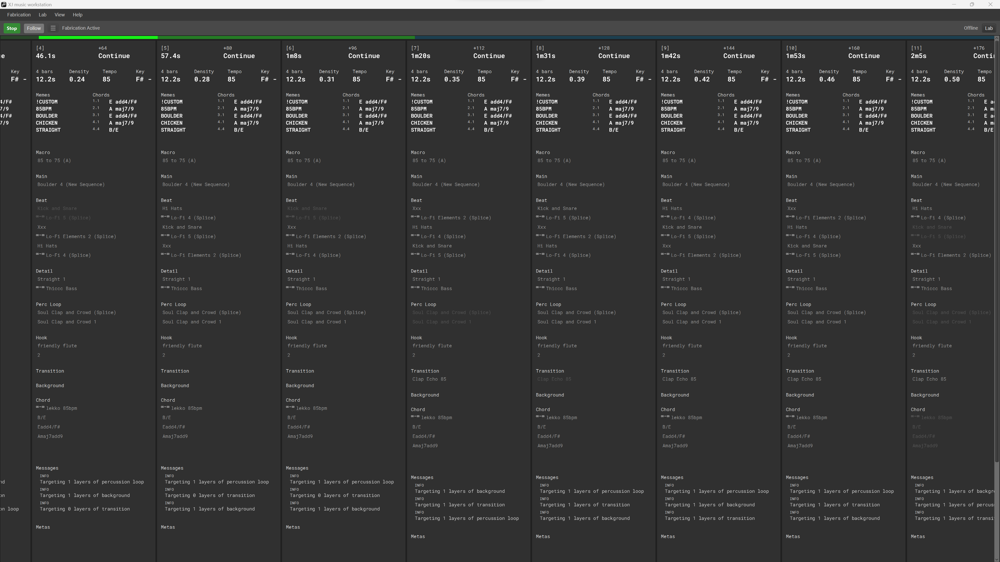

 

 

# Adaptive music engine

XJ music is the first end-to-end solution built specifically for adaptive ambient music, enabling composers to realize new possibilities.

XJ includes the [XJ music workstation](workstation/README.md), a DAW dedicated to preparing adaptive video game music, and the 
[XJ music engine](engine/README.md) to integrate the product within your game audio system.

Download and install the XJ music workstation to start creating adaptive music for video games. You can download the latest version of the XJ music workstation from [xjmusic.com/download](https://xjmusic.com/download).

## Getting started

First, [Download the XJ music workstation](https://xjmusic.com/download) and follow the [installation instructions](https://docs.xjmusic.com/installation/).

Then, read the [getting started documentation](https://docs.xjmusic.com/getting-started/), which shows you how to create one of our Demo projects so you can start checking out the workstation right away.

The source files for the demos are hosted [here](https://github.com/xjmusic/xjmusic-demos)

When you're ready to integrate XJ music into your game, check out the [Unreal Engine Plugin](https://github.com/xjmusic/UnrealPlugin/) or go directly to the [C++ playback engine](https://github.com/xjmusic/xjmusic/tree/main/engine/) and [its documentation](https://engine-docs.xjmusic.com/).

---

# THE NEXT LEVEL: XJ v2

**Play adaptive music like an instrument. Share a library like a crew. Keep a whole room in the same tempo and the same chord changes.**

XJ music began with two samplers wired to one hard drive: one machine holding the groove, the other tearing it apart, both playing the same show. Version 2 builds that room in real life. The patented engine that composes adaptive soundtracks for games becomes the heart of a live performance workstation.

**The mission:** lift the performer above the sequencer. The machine handles the lowest level of the music, so you get to do the part that matters: steer it, play it, and connect with the audience and the other players.

**Where it stands:** The plan is public and open for comment. Work starts with Phase 0 spikes that end in a go/no-go on the plan, then Engine 2.0. Today's download is XJ music 1.9, and it is the best way to start making adaptive music now.

## For musicians

- **It makes music within seconds of launch.** No project to build first. The workstation opens in Play mode with a starter pack already playing.
- **You steer, it composes.** Cue where the music goes next and land changes on the beat, the bar, or the section. Fire drops, sweeps, fills, and stutters in the moment, from a pad controller, a keyboard, or the screen.
- **You always know what it will do.** Every choice the engine makes is on screen, and every control shows what it will do before you touch it.
- **Bring your sound, share the stage.** Bring your own material and draw on the open Commons, a library of signed, licensed packs that maintainers approve by ear. Everything you play is chosen to fit the shared harmony and tempo.
- **Two stations, one song.** Join a session on the venue network and every station follows the same tempo and chord changes. Claim the drums and bass, and the other station plays everything else. Trade the lead back and forth at a section boundary, with no dropout. Ableton Link, once Ableton licenses it, or MIDI clock keeps your other gear in time.
- **Still made for games.** A game soundtrack and a live set are the same content, and the workstation keeps building adaptive music for Unreal and other game engines.

## For hackers

- **Engine 2.0.** The C++ craft engine stays the single source of musical truth, behind a stable C ABI, with seeded randomness so a performance can be replayed and two stations compared.
- **A Rust workstation on a station runtime** that also runs headless, in a venue rack or in CI: real-time DSP, Link, MIDI and OSC mapping, capture and replay.
- **The Commons.** Versioned, content-addressed, signed packs, a static registry with no server to run, and a lint that understands music.
- **Sessions.** An open protocol for a venue network, in which one station conducts a harmonic timeline published bars ahead of the beat and every other station crafts its own layers against it.
- **Designed in the open, down to the acceptance criteria.** Read [the V2 proposal](design/v2-proposal/README.md), browse [the roadmap](https://github.com/xjmusic/xjmusic/issues/480), which indexes every phase, epic, and task, pick an issue, and build it with us. Log your hours against your pull request; if it merges, each hour earns one point of equity in XJ music, as [described below](#earning-equity-in-xj-music).

The 1.9 workstation stays the editor of record until the new editors reach parity, and moves to maintenance once Engine 2.0 ships. Nothing you make today is left behind: both read and write the same project files.

---

## Patented technology, open source codebase

The underlying technology is protected by [U.S. Patent 10,446,126](https://patents.google.com/patent/US10446126B1/)
You may use the XJ music engine completely free for projects with a budget under $250K.
For larger projects, contact licensing@xjmusic.com for a license.

## Community and contributing

XJ music is an ever-growing community of users and developers.

The best way to get in touch with the core engine developers is to join the
[XJ music Discord](https://discord.xj.io).

To get started contributing to the project, see the [contributing guide](CONTRIBUTING.md).
This document also includes guidelines for reporting bugs.

### Earning Equity in XJ music

All contributors to XJ music, including the founder, director of engineering, and lead developer Charney Kaye, earn equity in the company based on the following formula: 1 hour of labor = 1 point of equity. Developers report all hours against specific Pull Requests. If you would like to contribute to the XJ music codebase and earn equity in the company, prepare your code in a Pull Request and [contact us](https://xjmusic.com/contact-us/) with a log of your hours corresponding to that work. If we accept and merge your pull request into the main branch, we'll sign a contract guaranteeing your share of future revenue.

## Documentation

The official documentation is published at [docs.xjmusic.com](https://docs.xjmusic.com).
It is maintained by the XJ music community in its own [GitHub repository](https://github.com/xjmusic/xjmusic-docs).

C++ class documentation for the in-game runtime engine is available at [engine-docs.xjmusic.com](https://engine-docs.xjmusic.com).
