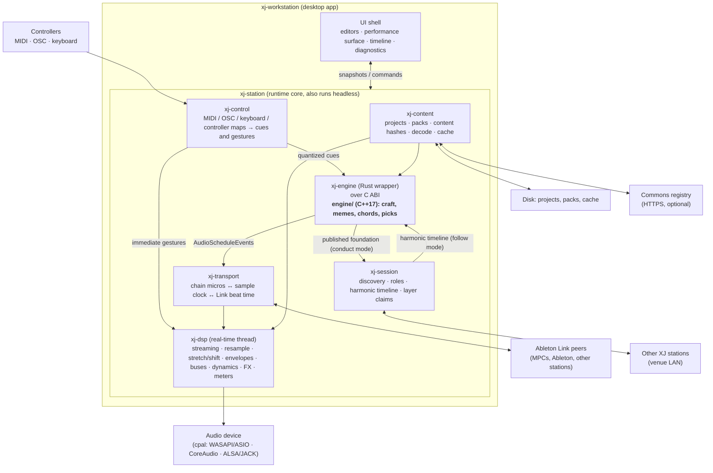
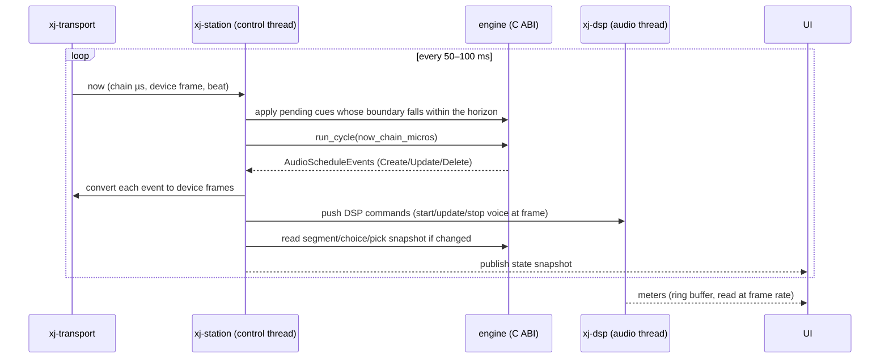

# 03 · V2 architecture

This document describes the shape of the V2 system: what the pieces are, which language each is in, where the boundaries sit, and how time and data move across them. Later documents go deep on each piece.

## One sentence

**The C++ engine remains the brain; a Rust body gives it ears, hands, a face and a network; and the body is the same whether it runs as a desktop workstation, a headless station in a venue rack, or a test harness in CI.**

## System diagram



## Components

### `engine/` (C++17, unchanged core plus a new C ABI)

The existing library in [`engine/`](../../engine/). It owns content entities, the segment store, the fabricator, the five craft stages, meme logic, chord and voicing math, and the work cycle that turns time into `AudioScheduleEvent`s. V2 adds a flat, versioned C ABI, a follow mode fed by an external harmonic timeline, seeded randomness, boundary-quantized cue semantics, and richer diagnostics. Its public C++ API stays for existing consumers such as the Unreal plugin. Details: [04-engine.md](04-engine.md).

### `xj-engine-sys` and `xj-engine` (Rust)

`xj-engine-sys` is generated bindings over the C ABI (via `bindgen` at build time, or checked-in bindings regenerated by a script). `xj-engine` is the safe Rust wrapper: an `Engine` type whose ownership rules make misuse a compile error, `run_cycle` returning typed events, overrides and cues as methods, and read-only snapshots of segments, choices and picks for the UI. The C++ build is driven by `cmake` from `build.rs`, producing a static library linked into the Rust binary. No shared library at runtime, no JNI, no process boundary.

### `xj-dsp` (Rust, real-time)

The hands. A real-time audio graph that plays scheduled audio exactly when the engine says, and nothing that requires the engine. Responsibilities: streaming decoded sample data from the content cache, resampling to device rate, optional pitch shift and time stretch, per-voice amplitude envelopes (the from-volume to to-volume ramp plus release), one bus per instrument type as in the Java mixer, the look-ahead compressor and filters configured in `TemplateConfig`, a small set of performance effects per bus, metering, and output sinks (device, WAV capture, later HLS). It runs on the audio callback thread with no allocation, no locks and no I/O; everything reaches it through lock-free queues. Details: [05-workstation.md](05-workstation.md), section "DSP layer".

### `xj-transport` (Rust)

The clock. Owns the single mapping between the engine's chain microseconds, the audio device's sample position, Ableton Link's beat timeline and wall-clock time. Converts each `AudioScheduleEvent` into a sample-accurate DSP command. Exposes "now" in every time base to everyone else. Handles start, stop, tempo changes from Link, and drift correction. Details: [07-session-protocol.md](07-session-protocol.md), section "Clock".

### `xj-session` (Rust)

The venue. Peer discovery on the LAN, session membership, the conductor and follower roles, publication and consumption of the harmonic timeline, layer claims, role handoff, and presence. Speaks a small JSON message set over a framed transport. Details: [07-session-protocol.md](07-session-protocol.md).

### `xj-control` (Rust)

The performer's hands. Reads MIDI (`midir`), OSC, keyboard and gamepad, applies a user-editable mapping, and emits one of two things: a **cue** (quantized to a musical boundary, goes to the engine) or a **gesture** (immediate, goes to the DSP). Also carries the "what will this do" metadata the UI shows before a control is touched. Details: [08-performer-input.md](08-performer-input.md).

### `xj-content` (Rust)

The library. Reads and writes V1 projects unchanged (the `.xj` file plus the `libraries/**` and `templates/**` JSON exactly as the current workstation writes them), reads and writes Commons packs, computes content hashes for audio, decodes audio with `symphonia` into the cache in the format the DSP wants, and talks to the registry. Replaces the Java `ProjectManager`, the `AudioCache`, and the ffmpeg-based conversion. Details: [06-commons.md](06-commons.md).

### `xj-station` (Rust)

The runtime that composes everything above into one thing that runs. It owns the control thread (the engine tick loop at 10 to 20 Hz, cue scheduling, session I/O), spawns the DSP thread, and publishes state snapshots. It has no UI dependency, so it builds as a CLI for venue racks, soak tests and CI:

```bash
xj-station play ./MyShow.xj --template Main --link --session "Boulder Night 3" --role follow
```

The desktop app is `xj-station` plus a UI.

### `xj-workstation` (Rust plus UI)

The desktop application. Content editors, the performance surface, the fabrication timeline, diagnostics, settings, packaging. The toolkit decision is deferred to a Phase 0 spike with explicit criteria in [05-workstation.md](05-workstation.md).

## Threads and real-time rules

| Thread | Owner | Cadence | May block? | Talks to |
|---|---|---|---|---|
| Audio callback | `xj-dsp` | Device buffer (e.g. 256 frames at 48 kHz, about 5 ms) | **Never** | Reads the command ring buffer, writes the meter ring buffer |
| Control | `xj-station` | 10–20 Hz tick, plus event-driven | Briefly (a segment craft can take tens of ms) | Engine, transport, session, control mapping, DSP command queue |
| I/O | `xj-content`, `xj-session` | Event-driven | Yes | Disk, network, decode worker pool |
| UI | `xj-workstation` | Frame rate | Never for long | Reads state snapshots, sends commands to the control thread |

Rules enforced by construction rather than convention:

- The audio thread receives commands through a single-producer single-consumer ring buffer (`rtrb` or equivalent). Sample data is pre-decoded into shared immutable buffers by the I/O thread and handed over by reference. The audio thread never decodes, never opens files, never allocates.
- The UI reads state through swap-on-write snapshots (`arc-swap` or a triple buffer). No mutex is shared between the UI and the control thread.
- Engine craft runs on the control thread. The craft horizon is large enough that a 50 ms craft never threatens the audio thread, because audio for the next several seconds is already scheduled.

## Time model

Four time bases exist, and exactly one component is allowed to convert between them.

| Base | Unit | Origin | Owner |
|---|---|---|---|
| Chain time | microseconds | Start of the engine's chain | `engine/` (as today) |
| Device time | sample frames | Device stream start | `xj-dsp` |
| Beat time | beats (f64) | Link session timeline | Link, via `xj-transport` |
| Wall time | nanoseconds | OS monotonic clock | OS |

`xj-transport` maintains chain time as an affine function of device frames, re-estimated continuously, and beat time as a function of wall time from Link. A scheduled event with a start in chain microseconds becomes a DSP command with an absolute device frame. Tempo changes from Link alter the engine's view of tempo for *future* segments only (see [04-engine.md](04-engine.md), "Tempo as input"), so already-scheduled audio never needs to be re-timed.

## Data flow in one engine cycle



Immediate gestures (a filter sweep, a one-shot hit, a bus mute) bypass this loop: `xj-control` pushes DSP commands directly, stamped with the device frame of the next buffer boundary, or quantized to the next beat using the transport's mapping. The engine never learns about them, which is the point.

## Contracts

Three contracts define V2 and should be versioned independently of the code that implements them.

1. **Engine C ABI** (`engine/include/xjmusic/xj_c.h`). Flat C structs, opaque handles, an explicit ABI version query. Everything the Rust side and third-party hosts need; nothing more. Specified in [04-engine.md](04-engine.md).
2. **DSP command set.** The vocabulary the control thread uses to talk to the audio thread. Internal to the Rust workspace, but written down, because it is also the boundary where a future plugin host or a future C ABI for `xj-dsp` would attach.
3. **Session protocol.** The JSON message schema exchanged between stations, published so that non-XJ participants (a lighting desk, a Max patch, a VJ rig) can at least read the harmonic timeline. Specified in [07-session-protocol.md](07-session-protocol.md).

The content format is a fourth contract, inherited from V1 and extended additively in [06-commons.md](06-commons.md).

## What happens to each V1 piece

| V1 piece | Location | V2 disposition |
|---|---|---|
| C++ engine | `engine/` | **Kept.** Gains C ABI, follow mode, seeds, cues, diagnostics. Becomes 2.0. |
| Java craft, fabricator and work (the second engine) | `io.xj.engine.{craft,fabricator,work}` | **Retired.** One engine, in C++. The Java tests that encode musical expectations are mined for C++ test cases first. |
| Java mixer | `io.xj.engine.mixer` | **Replaced** by `xj-dsp`, which reproduces its bus and dynamics design. |
| Java ship (local playback, WAV, HLS) | `io.xj.engine.ship` | Local playback and WAV capture are `xj-dsp` sinks in 2.0. HLS is a later sink. |
| Java audio cache and ffmpeg via javacpp | `io.xj.engine.audio`, `mixer/FFmpegUtils` | **Replaced** by `xj-content` with `symphonia` decoding and `rubato` resampling. No ffmpeg dependency. |
| JavaFX content editors | `io.xj.gui.controllers.content.*` | **Rebuilt progressively** in the Rust workstation. The Java workstation remains the editor of record until parity ([09-roadmap.md](09-roadmap.md)). |
| Fabrication tab | `io.xj.gui.controllers.fabrication` | **Superseded** by the performance surface and the timeline view. |
| Project manager, Build, Export | `io.xj.gui.project` | **Replaced** by `xj-content`. "Build for engine" (pre-rendered WAVs for Unreal) stays as an export. |
| Hub client, JSON:API, user and auth entities, telemetry | `io.xj.engine.hub_client`, `io.xj.model.jsonapi`, `io.xj.engine.telemetry` | **Dropped.** Cloud-era remnants. The Commons registry is a different, simpler thing. |
| Example terminal player | `engine/example/` | **Kept** as the engine's smoke test. `xj-station` becomes the primary headless runtime. |
| Unreal plugin | separate repo | **Kept.** Moves from the C++ API to the C ABI when convenient; gains the option to use `xj-dsp` through its own C ABI later. |

## Deployment shapes

The same `xj-station` core runs as:

- **Desktop workstation** on Windows, macOS and Linux. This is the product.
- **Headless station** in a venue rack, driven by controllers and the session, with a web status page instead of a GUI.
- **Test harness** in CI: load a project, run N minutes of chain faster than real time against a null audio device, assert on the choices and on rendered audio statistics.
- **Browser demo** (an opportunity, not a commitment): the C++ engine compiles to WebAssembly without changes to its core, and the Rust crates target `wasm32` with a Web Audio sink. A Commons pack could be auditioned in a browser before download.
