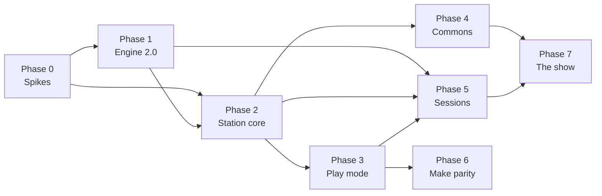

# 09 · Roadmap

Phases, exit criteria, rough sizing, and what stays running from V1 while V2 is built. Every exit criterion is a demonstration, not a document. Sizing is in engineer-months with an honest uncertainty, because the people who will do this work have not yet estimated it.

## Principles

1. **Something usable ships at the end of every phase.** No phase ends with only infrastructure.
2. **The game-audio product never regresses.** Engine 2.0 reads 1.9 projects; "Build for engine" exists from the first Rust workstation release; the Unreal plugin builds against every engine tag.
3. **The Java workstation stays the editor of record until the Rust editors reach parity.** It goes into maintenance mode (bug fixes, no features) when Phase 1 ends, and is archived when Phase 6 ends. Both applications read and write the same files throughout.
4. **Decisions have dates.** Phase 0 exists to turn the open questions in [10-risks-and-open-questions.md](10-risks-and-open-questions.md) into decisions recorded in this folder.
5. **The craft tests are the acceptance test.** Nothing merges to the engine that fails the existing matrix.

## Phases

### Phase 0 · Spikes and decisions

**Goal:** retire the biggest unknowns with small, throwaway experiments.

| Spike | Question | Done when |
|---|---|---|
| C ABI | Can a Rust binary link the engine statically on Windows, macOS and Linux from `build.rs`, and run the test project through `cpal`? | A 300-line Rust program plays the test project on all three platforms in CI |
| Craft timing | How long does a segment craft take on a laptop, per craft stage, on the demo projects? | Numbers in a table in this folder; informs horizons |
| UI toolkit | Candidate A or B ([05-workstation.md](05-workstation.md))? | Both spikes built; criteria scored; decision recorded |
| Stretch and shift | Does Signalsmith Stretch (or a Rust alternative) sound good enough on loops and tonal samples at ±4 semitones and 0.85–1.2×? | Blind listening by three musicians; decision recorded |
| Link | Does `rusty_link` lock a Rust process to an MPC and to Ableton Live on a LAN? What is the license path? | Demo on real hardware; legal answer recorded |
| Taxonomy | What are the base categories? | Drafted with the people who will author the first packs |

**Exit:** every row above has a recorded decision. The C ABI spike becomes the seed of `xj-engine-sys`.

**Size:** 1.5–2.5 engineer-months, calendar 6–8 weeks, ideally two people in parallel.

### Phase 1 · Engine 2.0

**Goal:** everything in [04-engine.md](04-engine.md).

- C ABI, complete, with C tests in CI.
- Seeded randomness and determinism tests.
- Cues with boundaries, commit horizon, `earliest_landing`.
- Tempo policy.
- Foundation source: internal, external; conduct-mode publication; follow-mode ingestion; hold and rejoin.
- Preview and choice diagnostics behind flags.
- Additive content fields for pitch shift and stretch.
- Craft timing reported as segment messages.
- Doxygen updated; engine docs site updated.

**Exit:** the follow-mode test (two engines, one conducting, one following, identical foundations per span) is green on three platforms; engine 2.0.0 is tagged; the Unreal plugin builds against it unchanged.

**Size:** 3–4 engineer-months.

### Phase 2 · Station core

**Goal:** the headless runtime from [03-architecture.md](03-architecture.md), driven from a terminal and a MIDI controller.

- `xj-engine` safe wrapper.
- `xj-dsp`: voices, buses, master dynamics ported from the Java mixer, insert effects, sinks (device, WAV, null), capture.
- `xj-transport`: time model, Link integration behind a feature flag pending the license decision.
- `xj-content`: V1 project read and write, `symphonia` decode, content-hash cache, Build for engine.
- `xj-control`: MIDI, OSC, keyboard, mapping file, learn mode in the CLI (print what you touched).
- `xj-station` CLI with `play`, `render`, `capture`, `replay`.
- CI: offline render of the demo projects with audio statistics asserted; 8-hour soak on a schedule.

**Exit:** `xj-station play` on a V1 demo project, with a MIDI controller driving cues and gestures, sounds at least as good as the Java workstation to the maintainers' ears, runs 8 hours without a dropout, and `replay` of a capture reproduces its chain byte for byte.

**Size:** 4–5 engineer-months.

### Phase 3 · Workstation 2.0, Play mode

**Goal:** the instrument from [05-workstation.md](05-workstation.md).

- Application shell in the chosen toolkit; settings; packaging and signing for three platforms; auto-update.
- Performance surface: scenes, palettes, intensity, cue boundary, harmony strip, layers, advance and hold, capture.
- Timeline with the "why" panel.
- Controller mapping UI with learn mode and LED feedback.
- Starter pack bundled; first-run tour.
- Ship mode: Build for engine, bounce, capture export.

**Exit:** first launch to sound in under 10 s on a 2019 laptop; a musician who has never seen XJ performs for 20 minutes with a pad controller after the tour; five usability sessions run and their findings filed as issues.

**Size:** 5–7 engineer-months. The UI toolkit decision moves this range more than anything else.

### Phase 4 · Commons

**Goal:** [06-commons.md](06-commons.md). Can overlap with Phase 3.

- Pack format, manifest, content hashing, provenance fields.
- `xj-content` CLI: pack, lint, verify, publish, fetch, lock, render.
- Static registry index and artifact hosting; signing.
- The four demo projects as packs; the starter pack; previews.
- Base taxonomy published and versioned.
- Licensing text for packs in the docs.
- Export pack from the workstation.

**Exit:** a fresh install fetches a show from the registry, writes a lockfile, and two machines with the same lockfile load byte-identical content; one external contributor publishes a pack that passes lint.

**Size:** 2–3 engineer-months of engineering, plus content work that is not engineering and is not sized here.

### Phase 5 · Sessions

**Goal:** [07-session-protocol.md](07-session-protocol.md).

- `xj-session`: discovery, join code, connection, messages, roles, claims, cue requests, handoff, failure handling.
- Session panel on the surface; claim indicators on the layer strips; effective-horizon display.
- Simulated-network tests; three-station soak; handoff soak.
- Headless station web status page.

**Exit:** two workstations and one MPC on Link in one room play a 30-minute duet with two handoffs and no dropout, recorded as captures on both stations; the recording is published as the proof.

**Size:** 3–4 engineer-months.

### Phase 6 · Make mode parity

**Goal:** retire the Java workstation.

- Instrument and audio editor (first, because packs need it).
- Template editor.
- Program editor: bind, chord, event modes.
- Migration guide; Java workstation archived.

**Exit:** every editing operation in the Java workstation has an equivalent in the Rust workstation; the Java repository folder is archived with a pointer.

**Size:** 5–8 engineer-months. The program editor is most of it.

### Phase 7 · The show

Not an engineering phase. A real night with three or more stations, with artists who were not involved in building the software, in a venue, with an audience. Its exit criterion is a recording that stands beside *Live in Boulder*.

## Dependencies and parallelism

Phase 1 and the non-engine parts of Phase 2 run in parallel once the C ABI spike is done. Phase 4 runs alongside Phase 3. Phase 6 can start as soon as Phase 3's shell exists and runs alongside Phase 5.

## Sizing summary

| Phase | Engineer-months | Notes |
|---|---|---|
| 0 Spikes | 1.5–2.5 | |
| 1 Engine 2.0 | 3–4 | |
| 2 Station core | 4–5 | |
| 3 Play mode | 5–7 | Toolkit-dependent |
| 4 Commons | 2–3 | Plus unsized content work |
| 5 Sessions | 3–4 | |
| **Phases 0–5** | **18.5–25.5** | The vision, minus editor parity |
| 6 Make parity | 5–8 | |
| **Phases 0–6** | **23.5–33.5** | |

With two engineers working steadily, Phases 0–5 are roughly 12–16 calendar months and Phases 0–6 roughly 16–22. These are planning numbers with an uncertainty of about ±50%, to be replaced by estimates from the people doing the work at the start of each phase. In the equity model in the README, where one hour of labor is one point, the lower bound of Phases 0–6 is on the order of 4,000 hours.

## Decision gates

| After | Decision |
|---|---|
| Phase 0 | Toolkit; stretch library; Link path; go/no-go on the plan as a whole |
| Phase 2 | Does the station core sound good enough to build a product on? If not, the DSP gets another phase before any UI work |
| Phase 3 | Do musicians want to play it? Usability findings decide the shape of Phase 6 and the scope of Phase 5 |
| Phase 5 | Did the duet work in a real room? Decides whether Phase 7 is scheduled |

## From this folder to issues

Once the shape is agreed, each phase becomes a GitHub milestone and each bullet becomes one or more issues labeled `v2` and the phase. The documents in this folder are updated as decisions are made, so that the folder remains the single description of the plan rather than becoming a historical artifact the issues drift away from.

## Version numbers

- Engine: 2.0.0 at the end of Phase 1; the C ABI at 1.0.0.
- Workstation: 2.0.0 at the end of Phase 3 (Play mode, Ship mode, no editors); 2.1 for Commons; 2.2 for Sessions; 2.x as editors land; the Java workstation stays at 1.9.x.
- Content format: unchanged major; additive fields documented per release.
