# 12 · Work breakdown

*Generated from [roadmap/](roadmap/) by `roadmap/tools/work_breakdown.py`. Do not edit by hand; change `master.json` and regenerate.*

The plan of [09-roadmap.md](09-roadmap.md) as a waterfall of issues: one milestone per phase, one epic per capability, one task per unit of work, with formal *blocked by* links. The issues live in [project #7](https://github.com/orgs/xjmusic/projects/7) under the umbrella [#480](https://github.com/xjmusic/xjmusic/issues/480). Every task body carries a full specification (context, scope, design, acceptance criteria, test plan, dependencies, risks, references).

**Shape:** 63 epics, 304 tasks, 1296.5 engineer-days of estimates. Two engineers from 2026-11-16 to 2029-06-28 on the list schedule below. Estimates are planning numbers with the ±50% uncertainty 09 states, re-estimated at each decision gate by the people doing the work.

## Phases at a glance

| Phase | Epics | Tasks | Engineer-days | About engineer-months | 09's band | Scheduled |
|---|---|---|---|---|---|---|
| 0 · Spikes and decisions | 10 | 33 | 92 | 4.4 | 1.5–2.5 | 2026-11-16 → 2027-01-12 |
| 1 · Engine 2.0 | 11 | 72 | 292 | 13.9 | 3–4 | 2027-01-11 → 2027-08-09 |
| 2 · Station core | 11 | 65 | 292 | 13.9 | 4–5 | 2027-08-06 → 2028-03-01 |
| 3 · Workstation 2.0, Play mode | 10 | 42 | 185.5 | 8.8 | 5–7 | 2028-02-03 → 2028-07-12 |
| 4 · Commons | 8 | 33 | 121 | 5.8 | 2–3 | 2028-02-03 → 2028-09-28 |
| 5 · Sessions | 7 | 27 | 140 | 6.7 | 3–4 | 2028-09-06 → 2029-01-31 |
| 6 · Make mode parity | 5 | 22 | 140 | 6.7 | 5–8 | 2029-01-30 → 2029-06-28 |
| 7 · The show | 1 | 10 | 34 | 1.6 | not engineering | 2029-01-25 → 2029-05-22 |

Engineer-months divide days by 21. Phase 1 exceeds 09's band because the grounded research found port regressions, seven randomness sites and ABI hardening the proposal did not know about; Phase 6 undershoots it because the shared editing infrastructure absorbs most of the Java editors (see [roadmap/decomposition-rationale.md](roadmap/decomposition-rationale.md)).

## Critical path

The longest chain of estimates, with unlimited parallelism, is 231 engineer-days over 41 tasks:

| Day | Task |
|---|---|
| 2 | [#571](https://github.com/xjmusic/xjmusic/issues/571) Check in the four demo build payloads as JSON-only engine fixtures from xjmusic-demos |
| 4 | [#572](https://github.com/xjmusic/xjmusic/issues/572) Check in the craft-timing harness as an engine target with a per-segment delta dump |
| 6 | [#487](https://github.com/xjmusic/xjmusic/issues/487) Decide which 1.9.6 behaviors are the reference where the C++ port diverged from Java |
| 13 | [#584](https://github.com/xjmusic/xjmusic/issues/584) Mine the Java craft tests for expectations the C++ matrix lacks before retiring Java |
| 17 | [#591](https://github.com/xjmusic/xjmusic/issues/591) Restore delta accumulation and the intensity crescendo, updating the foundation fixtures |
| 24 | [#600](https://github.com/xjmusic/xjmusic/issues/600) Write the determinism tests and a three-platform craft golden before touching any RNG |
| 29 | [#601](https://github.com/xjmusic/xjmusic/issues/601) Thread the engine-owned generator through all seven RNG sites in one PR, nothing else |
| 31 | [#602](https://github.com/xjmusic/xjmusic/issues/602) Derive a per-segment sub-seed so a cue rewrite reproduces the same future |
| 41 | [#622](https://github.com/xjmusic/xjmusic/issues/622) Implement the cue queue, cut-at-boundary rewrite, cancel and the landing acknowledgement |
| 47 | [#625](https://github.com/xjmusic/xjmusic/issues/625) Implement the Intensity cue with a ramp and Layer Mute as a deterministic per-type flag |
| 51 | [#627](https://github.com/xjmusic/xjmusic/issues/627) Write the cue test family: boundary exactness, NOW-only refusal, cancel and collisions |
| 58 | [#628](https://github.com/xjmusic/xjmusic/issues/628) Implement Engine::preview over a scratch store copy; test preview equals the real result |
| 59 | [#631](https://github.com/xjmusic/xjmusic/issues/631) Expose xj_engine_preview_cue_json through the ABI with a C test and buffer-ownership check |
| 61 | [#676](https://github.com/xjmusic/xjmusic/issues/676) Add typed cue, override, tempo, seed and preview methods to Engine |
| 70 | [#693](https://github.com/xjmusic/xjmusic/issues/693) Implement the control-thread tick loop: cue scheduling, event conversion, snapshots |
| 74 | [#700](https://github.com/xjmusic/xjmusic/issues/700) Wire BeatClock tempo into the engine's External policy and engine tempo into the clock |
| 80 | [#703](https://github.com/xjmusic/xjmusic/issues/703) Ship xj-station play: the first shippable Rust binary that makes music from a V1 project |
| 84 | [#699](https://github.com/xjmusic/xjmusic/issues/699) Implement TOML settings with Play-mode horizon defaults, logging, diagnostics bundle |
| 93 | [#707](https://github.com/xjmusic/xjmusic/issues/707) Schedule the 8-hour soak with dropout, late-command, xrun and memory assertions |
| 96 | [#708](https://github.com/xjmusic/xjmusic/issues/708) Run xj-station play eight hours on a real audio device on each OS before the Phase 2 gate |
| 98 | [#709](https://github.com/xjmusic/xjmusic/issues/709) Hold the Phase 2 A/B listening gate against the Java workstation and record the decision |
| 106 | [#713](https://github.com/xjmusic/xjmusic/issues/713) Build the application shell: modes, navigation, settings, About, recents, window state |
| 115 | [#724](https://github.com/xjmusic/xjmusic/issues/724) Embed xj-station in the app with the snapshot stream and command channel |
| 124 | [#725](https://github.com/xjmusic/xjmusic/issues/725) Build the canvas surface component from the view-model and benchmark it on a 2019 laptop |
| 129 | [#734](https://github.com/xjmusic/xjmusic/issues/734) Ship one scene pad with preview, landing time, audible Macro cue and the boundary picker |
| 133 | [#732](https://github.com/xjmusic/xjmusic/issues/732) Build the ten layer strips with meters, mute and solo as gesture plus cue, claim indicator |
| 137 | [#733](https://github.com/xjmusic/xjmusic/issues/733) Build on-screen gestures: one-shot pads with audio picker, bus gain, FX, stutter, fill |
| 145 | [#743](https://github.com/xjmusic/xjmusic/issues/743) Make the whole surface drivable from the keyboard with screen-reader labels |
| 150 | [#739](https://github.com/xjmusic/xjmusic/issues/739) Build the three-step first-run tour with previews and a controller prompt |
| 154 | [#812](https://github.com/xjmusic/xjmusic/issues/812) Build the library browser with create, duplicate, move, delete and navigation history |
| 158 | [#811](https://github.com/xjmusic/xjmusic/issues/811) Build config editors validated against the C++ parser dialect and suggested meme entry |
| 162 | [#813](https://github.com/xjmusic/xjmusic/issues/813) Build the instrument editor: fields, memes, config, audios table, import |
| 166 | [#814](https://github.com/xjmusic/xjmusic/issues/814) Import audio in any decodable format and propose loopBeats and tempo from the file |
| 174 | [#815](https://github.com/xjmusic/xjmusic/issues/815) Build the audio editor with waveform, transient and loop markers, zoom and all fields |
| 181 | [#817](https://github.com/xjmusic/xjmusic/issues/817) Build the program editor shell: fields, type cascade, sequence management, grid, zoom |
| 190 | [#820](https://github.com/xjmusic/xjmusic/issues/820) Build event edit mode: voices, tracks, patterns and draggable events |
| 199 | [#833](https://github.com/xjmusic/xjmusic/issues/833) Add event multi-select, group edit, the properties dialog, and copy and paste |
| 205 | [#821](https://github.com/xjmusic/xjmusic/issues/821) Add keyboard note entry and drag reorder; make the Rust program editor the default |
| 215 | [#825](https://github.com/xjmusic/xjmusic/issues/825) Audit every Java editing operation against its Rust equivalent; run pack-author sessions |
| 219 | [#826](https://github.com/xjmusic/xjmusic/issues/826) Write the migration guide from the Java workstation to the Rust editors |
| 231 | [#827](https://github.com/xjmusic/xjmusic/issues/827) Archive the Java workstation with a pointer and retire the Java round-trip CI |

## Epic dependency graph

Each box is an epic; an arrow means *blocked by*. The tracker holds 342 epic edges, computed from the tasks' edges (an edge that would close a cycle between two epics whose tasks interleave is left out). The graph draws the 92 that no longer path already implies, so every dependency path is still visible.

```mermaid
flowchart LR
  subgraph P0["Phase 0 · Spikes and decisions"]
    e0_paperwork["#490 Send the week-one license paperwork and…"]
    e0_decisions["#481 Turn the open questions into dated…"]
    e0_c_abi_spike["#491 Prove a Rust binary can link the engine…"]
    e0_craft_timing["#492 Check in the craft-timing harness and…"]
    e0_ui_toolkit_spike["#493 Build the same performance-surface slice…"]
    e0_stretch_bakeoff["#494 Run the blind stretch and pitch-shift…"]
    e0_link_spike["#495 Lock a Rust process to an MPC and Ableton…"]
    e0_taxonomy_draft["#496 Draft xj-base@1 from the demo conventions…"]
    e0_controller_spike["#497 Verify what midir exposes and how the two…"]
    e0_tracker_ci_baseline["#498 Set up the V2 tracker and a Rust CI…"]
  end
  subgraph P1["Phase 1 · Engine 2.0"]
    e1_determinism["#499 Make craft deterministic: tests first…"]
    e1_port_fixes["#500 Fix the C++ port regressions that the 2.0…"]
    e1_c_abi_core["#501 Ship the C ABI core: header, lifecycle…"]
    e1_c_abi_hardening["#502 Run the ABI under sanitizers and fuzz it…"]
    e1_cues["#503 Implement cues with landing boundaries…"]
    e1_foundation["#504 Implement follow mode and conduct mode…"]
    e1_preview_diagnostics["#505 Add preview, choice diagnostics and…"]
    e1_abi_snapshots["#506 Complete the C ABI surface: snapshots…"]
    e1_content_fields["#507 Add the additive content fields and the…"]
    e1_engine_release_ci["#508 Modernize engine CI, decouple tags, ship…"]
    e1_engine_docs["#509 Update Doxygen and the docs site for…"]
  end
  subgraph P2["Phase 2 · Station core"]
    e2_rust_workspace["#510 Lay out the Rust workspace with a…"]
    e2_rust_engine["#511 Build xj-engine-sys and the safe…"]
    e2_content_v1_io["#512 Read and write V1 projects as the Java…"]
    e2_content_audio_cache["#513 Decode, resample and cache audio by…"]
    e2_transport["#514 Own the clock: four time bases, BeatClock…"]
    e2_dsp_core["#515 Build the real-time graph: voices, buses…"]
    e2_dsp_fx_sinks["#516 Add the insert effects and the device…"]
    e2_control["#517 Build xj-control: inputs, mapping file…"]
    e2_station_runtime["#518 Compose the headless xj-station runtime…"]
    e2_station_ci_soak["#519 Prove the station core in CI: render…"]
    e2_release_early["#520 Ship CLI releases on every tag so the…"]
  end
  subgraph P3["Phase 3 · Workstation 2.0, Play mode"]
    e3_shell["#521 Build the application shell in the chosen…"]
    e3_surface["#522 Build the performance surface: scenes…"]
    e3_timeline_why["#523 Build the timeline, the why panel and the…"]
    e3_mapping_ui["#524 Build the controller mapping UI with…"]
    e3_first_run["#525 Make first launch sound in under 10…"]
    e3_ship_mode["#526 Build Ship mode: Build for engine…"]
    e3_packaging["#527 Package, sign, notarize and auto-update…"]
    e3_release["#528 Release Workstation 2.0.0 after the…"]
    e3_usability["#529 Run the usability program that is the…"]
    e3_docs_workstation["#530 Write the Play-mode and Ship-mode guides…"]
  end
  subgraph P4["Phase 4 · Commons"]
    e4_pack_format["#531 Define the pack, show and lockfile…"]
    e4_content_cli["#532 Ship the xj-content CLI: pack, lint…"]
    e4_registry_infra["#533 Stand up the registry: index repository…"]
    e4_registry_publishing["#534 Run publishing through CI, document…"]
    e4_shows["#535 Make shows load byte-identical content on…"]
    e4_taxonomy_licensing["#536 Publish xj-base@1, clear the licensing…"]
    e4_seed_content["#537 Clear, correct and publish the four demos…"]
    e4_commons_ui["#538 Bring the Commons into the workstation…"]
  end
  subgraph P5["Phase 5 · Sessions"]
    e5_protocol_spec_docs["#539 Publish the versioned session protocol…"]
    e5_session_transport["#540 Build xj-session discovery, connection…"]
    e5_foundation_claims_cues["#541 Share the foundation: publish, retract…"]
    e5_session_clock["#542 Add the session BeatClock, the Link epoch…"]
    e5_session_ui["#543 Build the session panel, claim and…"]
    e5_session_testing["#544 Soak sessions: handoffs for an hour…"]
    e5_legal_docs_gate["#545 Clear the legal review, write the venue…"]
  end
  subgraph P6["Phase 6 · Make mode parity"]
    e6_editor_infra["#546 Build the editing infrastructure the Rust…"]
    e6_instrument_audio_editor["#547 Build the instrument and audio editor…"]
    e6_template_editor["#548 Build the template editor"]
    e6_program_editor["#549 Build the program editor in bind, chord…"]
    e6_parity_archive["#550 Audit parity, run pack-author sessions…"]
  end
  subgraph P7["Phase 7 · The show"]
    e7_show["#551 Produce the show: a real night, three or…"]
  end
  e0_c_abi_spike --> e0_decisions
  e0_controller_spike --> e0_decisions
  e0_craft_timing --> e0_decisions
  e0_link_spike --> e0_decisions
  e0_stretch_bakeoff --> e0_decisions
  e0_taxonomy_draft --> e0_decisions
  e0_ui_toolkit_spike --> e0_decisions
  e0_tracker_ci_baseline --> e0_c_abi_spike
  e0_paperwork --> e0_link_spike
  e1_port_fixes --> e1_determinism
  e0_decisions --> e1_port_fixes
  e1_determinism --> e1_c_abi_core
  e1_abi_snapshots --> e1_c_abi_hardening
  e1_determinism --> e1_cues
  e1_cues --> e1_foundation
  e1_cues --> e1_preview_diagnostics
  e1_c_abi_core --> e1_abi_snapshots
  e1_foundation --> e1_abi_snapshots
  e1_preview_diagnostics --> e1_abi_snapshots
  e1_c_abi_core --> e1_content_fields
  e1_cues --> e1_content_fields
  e1_c_abi_hardening --> e1_engine_release_ci
  e1_engine_docs --> e1_engine_release_ci
  e1_abi_snapshots --> e1_engine_docs
  e1_content_fields --> e1_engine_docs
  e0_c_abi_spike --> e2_rust_workspace
  e1_c_abi_hardening --> e2_rust_engine
  e2_rust_workspace --> e2_rust_engine
  e1_content_fields --> e2_content_v1_io
  e2_content_audio_cache --> e2_content_v1_io
  e2_rust_engine --> e2_content_v1_io
  e2_dsp_core --> e2_content_audio_cache
  e2_dsp_core --> e2_transport
  e2_rust_engine --> e2_transport
  e1_cues --> e2_dsp_core
  e2_rust_workspace --> e2_dsp_core
  e2_content_audio_cache --> e2_dsp_fx_sinks
  e2_transport --> e2_dsp_fx_sinks
  e2_dsp_fx_sinks --> e2_control
  e2_content_v1_io --> e2_station_runtime
  e2_control --> e2_station_runtime
  e2_station_runtime --> e2_station_ci_soak
  e1_engine_release_ci --> e2_release_early
  e2_station_runtime --> e2_release_early
  e1_engine_release_ci --> e3_shell
  e2_station_ci_soak --> e3_shell
  e3_mapping_ui --> e3_surface
  e3_timeline_why --> e3_surface
  e3_shell --> e3_timeline_why
  e3_shell --> e3_mapping_ui
  e3_ship_mode --> e3_first_run
  e3_surface --> e3_ship_mode
  e2_release_early --> e3_packaging
  e3_first_run --> e3_packaging
  e3_docs_workstation --> e3_release
  e3_packaging --> e3_usability
  e3_usability --> e3_docs_workstation
  e2_content_v1_io --> e4_pack_format
  e2_control --> e4_pack_format
  e4_registry_infra --> e4_content_cli
  e4_taxonomy_licensing --> e4_content_cli
  e4_pack_format --> e4_registry_infra
  e4_content_cli --> e4_registry_publishing
  e4_registry_publishing --> e4_shows
  e3_ship_mode --> e4_taxonomy_licensing
  e4_pack_format --> e4_taxonomy_licensing
  e3_first_run --> e4_seed_content
  e4_registry_publishing --> e4_seed_content
  e3_release --> e4_commons_ui
  e4_seed_content --> e4_commons_ui
  e4_shows --> e4_commons_ui
  e4_pack_format --> e5_protocol_spec_docs
  e4_shows --> e5_session_transport
  e5_protocol_spec_docs --> e5_session_transport
  e3_docs_workstation --> e5_foundation_claims_cues
  e5_session_clock --> e5_foundation_claims_cues
  e5_session_transport --> e5_session_clock
  e5_foundation_claims_cues --> e5_session_ui
  e3_release --> e5_session_testing
  e5_session_ui --> e5_session_testing
  e4_commons_ui --> e5_legal_docs_gate
  e5_session_testing --> e5_legal_docs_gate
  e3_first_run --> e6_editor_infra
  e4_taxonomy_licensing --> e6_editor_infra
  e5_legal_docs_gate --> e6_instrument_audio_editor
  e6_editor_infra --> e6_instrument_audio_editor
  e4_shows --> e6_template_editor
  e6_editor_infra --> e6_template_editor
  e6_instrument_audio_editor --> e6_program_editor
  e6_program_editor --> e6_parity_archive
  e6_template_editor --> e6_parity_archive
  e5_legal_docs_gate --> e7_show
```

## Phase 0 · Spikes and decisions

Scheduled 2026-11-16 → 2027-01-12. Exit criteria are in [09-roadmap.md](09-roadmap.md).

### [#490](https://github.com/xjmusic/xjmusic/issues/490) Send the week-one license paperwork and inventory content rights

Area `legal-paperwork` · 3 tasks · 4 engineer-days · blocked by nothing.

| Task | Size | Days | Blocked by | Scheduled |
|---|---|---|---|---|
| [#563](https://github.com/xjmusic/xjmusic/issues/563) Submit the Steinberg proprietary ASIO agreement and set the asio-feature gating stance | XS | 1 | — | 2026-11-16 → 2026-11-17 |
| [#564](https://github.com/xjmusic/xjmusic/issues/564) Inventory third-party material in the four demos and frame the relicensing question | S | 2 | — | 2026-11-16 → 2026-11-18 |
| [#565](https://github.com/xjmusic/xjmusic/issues/565) Send the Ableton Link proprietary license request and ask it to cover the binding fork | XS | 1 | — | 2026-11-16 → 2026-11-17 |

### [#481](https://github.com/xjmusic/xjmusic/issues/481) Turn the open questions into dated decision records

Area `decision` · 8 tasks · 13 engineer-days · blocked by #491, #497, #492, #495, #490, #494, #496, #493.

| Task | Size | Days | Blocked by | Scheduled |
|---|---|---|---|---|
| [#482](https://github.com/xjmusic/xjmusic/issues/482) Create the decision-record convention and record Q7, Q8, Q9, Q13, Q14 and four deferrals | S | 2 | — | 2026-11-16 → 2026-11-18 |
| [#483](https://github.com/xjmusic/xjmusic/issues/483) Record the company decisions on Q5 equity, Q6 license, Q11 telemetry and Q12 name | S | 2 | #482 | 2026-11-18 → 2026-11-20 |
| [#484](https://github.com/xjmusic/xjmusic/issues/484) Record platform floors and correct the audio-backend promises against cpal 0.18 | S | 2 | #482 | 2026-11-18 → 2026-11-20 |
| [#485](https://github.com/xjmusic/xjmusic/issues/485) Decide where V2 additive content fields live while the Java workstation still saves | XS | 1 | #482 | 2026-11-18 → 2026-11-19 |
| [#486](https://github.com/xjmusic/xjmusic/issues/486) Decide per-component release tags so engine 2.0.0 ships beside the Java 1.9.x line | XS | 1 | #482 | 2026-11-18 → 2026-11-19 |
| [#487](https://github.com/xjmusic/xjmusic/issues/487) Decide which 1.9.6 behaviors are the reference where the C++ port diverged from Java | S | 2 | #482, #572 | 2026-11-20 → 2026-11-24 |
| [#488](https://github.com/xjmusic/xjmusic/issues/488) Hold the Phase 0 gate: toolkit, stretch library, Link path, go/no-go on the plan | XS | 1 | #577, #567, #561, #573, #570, #483, #554, #565, #563, #558, #484, #487, #485, #486 | 2027-01-05 → 2027-01-06 |
| [#489](https://github.com/xjmusic/xjmusic/issues/489) Amend the proposal chapters with the Phase 0 corrections and cite each decision record | S | 2 | #484, #557, #487, #561, #577, #485, #486, #483, #567, #570, #488 | 2027-01-08 → 2027-01-12 |

### [#491](https://github.com/xjmusic/xjmusic/issues/491) Prove a Rust binary can link the engine statically and play the test project on three OS

Area `c-abi` · 2 tasks · 10 engineer-days · blocked by #498.

| Task | Size | Days | Blocked by | Scheduled |
|---|---|---|---|---|
| [#552](https://github.com/xjmusic/xjmusic/issues/552) Add a minimal xjmusic_c CMake target with install rule and gate the example app | S | 2 | — | 2026-11-16 → 2026-11-18 |
| [#554](https://github.com/xjmusic/xjmusic/issues/554) Write the Rust spike that links the engine from build.rs, plays via cpal, and report it | L | 8 | #552, #553, #482 | 2026-11-20 → 2026-12-02 |

### [#492](https://github.com/xjmusic/xjmusic/issues/492) Check in the craft-timing harness and repeat the measurement on a 2019 laptop

Area `engine` · 3 tasks · 6 engineer-days · blocked by nothing.

| Task | Size | Days | Blocked by | Scheduled |
|---|---|---|---|---|
| [#571](https://github.com/xjmusic/xjmusic/issues/571) Check in the four demo build payloads as JSON-only engine fixtures from xjmusic-demos | S | 2 | — | 2026-11-16 → 2026-11-18 |
| [#572](https://github.com/xjmusic/xjmusic/issues/572) Check in the craft-timing harness as an engine target with a per-segment delta dump | S | 2 | #571 | 2026-11-18 → 2026-11-20 |
| [#573](https://github.com/xjmusic/xjmusic/issues/573) Measure craft, rewrite and load timing on a 2019 laptop and the largest content | S | 2 | #572 | 2027-01-01 → 2027-01-05 |

### [#493](https://github.com/xjmusic/xjmusic/issues/493) Build the same performance-surface slice in Tauri 2 and iced on three OS and score it

Area `workstation-ui` · 4 tasks · 17 engineer-days · blocked by nothing.

| Task | Size | Days | Blocked by | Scheduled |
|---|---|---|---|---|
| [#574](https://github.com/xjmusic/xjmusic/issues/574) Define the surface view-model snapshot and a fake station stream for both toolkit slices | S | 2 | — | 2026-11-27 → 2026-12-01 |
| [#575](https://github.com/xjmusic/xjmusic/issues/575) Build the iced slice with a wgpu surface on Windows, macOS and Linux | M | 6 | #574 | 2026-12-18 → 2026-12-28 |
| [#576](https://github.com/xjmusic/xjmusic/issues/576) Build the Tauri 2 + Svelte slice with a Canvas2D surface on Windows, macOS and Linux | M | 6 | #574 | 2026-12-22 → 2026-12-30 |
| [#577](https://github.com/xjmusic/xjmusic/issues/577) Score both slices against the eight criteria and record the Q1 toolkit decision | S | 3 | #576, #575 | 2026-12-30 → 2027-01-04 |

### [#494](https://github.com/xjmusic/xjmusic/issues/494) Run the blind stretch and pitch-shift bake-off on fixed material

Area `dsp` · 2 tasks · 7 engineer-days · blocked by nothing.

| Task | Size | Days | Blocked by | Scheduled |
|---|---|---|---|---|
| [#566](https://github.com/xjmusic/xjmusic/issues/566) Assemble the fixed bake-off material and render it with Signalsmith Stretch and Bungee | M | 5 | — | 2026-12-11 → 2026-12-18 |
| [#567](https://github.com/xjmusic/xjmusic/issues/567) Hold the blind listening session and record the Q2 stretch-library decision | S | 2 | #566, #482 | 2026-12-18 → 2026-12-22 |

### [#495](https://github.com/xjmusic/xjmusic/issues/495) Lock a Rust process to an MPC and Ableton Live and measure beat-to-DAC alignment

Area `transport` · 3 tasks · 11 engineer-days · blocked by #490.

| Task | Size | Days | Blocked by | Scheduled |
|---|---|---|---|---|
| [#560](https://github.com/xjmusic/xjmusic/issues/560) Demonstrate a Rust process locking tempo and phase with an MPC and Ableton Live on a LAN | M | 4 | — | 2026-12-01 → 2026-12-07 |
| [#559](https://github.com/xjmusic/xjmusic/issues/559) Measure beat-to-DAC alignment under 3 ms per audio host and map cpal instants to Link time | M | 4 | #560, #484 | 2026-12-07 → 2026-12-11 |
| [#561](https://github.com/xjmusic/xjmusic/issues/561) Record the session epoch design and the Link-path decision | S | 3 | #560, #559, #482, #565 | 2026-12-11 → 2026-12-16 |

### [#496](https://github.com/xjmusic/xjmusic/issues/496) Draft xj-base@1 from the demo conventions and have the first pack authors review it

Area `commons` · 3 tasks · 8 engineer-days · blocked by nothing.

| Task | Size | Days | Blocked by | Scheduled |
|---|---|---|---|---|
| [#568](https://github.com/xjmusic/xjmusic/issues/568) Draft the xj-base@1 convention document from the demo analysis | S | 2 | — | 2026-12-28 → 2026-12-30 |
| [#569](https://github.com/xjmusic/xjmusic/issues/569) Measure loudness and true peak of the 3,000 demo audios to calibrate the level rule | M | 4 | — | 2027-01-04 → 2027-01-08 |
| [#570](https://github.com/xjmusic/xjmusic/issues/570) Review xj-base@1 with the first pack authors and record the Q4 decision | S | 2 | #568, #482 | 2026-12-30 → 2027-01-01 |

### [#497](https://github.com/xjmusic/xjmusic/issues/497) Verify what midir exposes and how the two reference 4x4 controllers light up

Area `control` · 2 tasks · 10 engineer-days · blocked by nothing.

| Task | Size | Days | Blocked by | Scheduled |
|---|---|---|---|---|
| [#557](https://github.com/xjmusic/xjmusic/issues/557) Enumerate both reference controllers through midir on three OS and prove the match key | M | 5 | #482 | 2026-11-20 → 2026-11-27 |
| [#558](https://github.com/xjmusic/xjmusic/issues/558) Verify Launchpad Programmer-mode and MPD218 LED behavior on hardware | M | 5 | #557 | 2026-12-02 → 2026-12-09 |

### [#498](https://github.com/xjmusic/xjmusic/issues/498) Set up the V2 tracker and a Rust CI baseline on three OS

Area `ci-release` · 3 tasks · 6 engineer-days · blocked by nothing.

| Task | Size | Days | Blocked by | Scheduled |
|---|---|---|---|---|
| [#553](https://github.com/xjmusic/xjmusic/issues/553) Stand up the Rust workspace skeleton with fmt, clippy, nextest and MSRV checks on three OS | S | 2 | — | 2026-11-18 → 2026-11-20 |
| [#555](https://github.com/xjmusic/xjmusic/issues/555) Create v2 labels, milestones and the project board, and reconcile conflicting issues | S | 2 | — | 2027-01-05 → 2027-01-07 |
| [#556](https://github.com/xjmusic/xjmusic/issues/556) Close subsumed open issues with V2 pointers; re-milestone the carry and stays-V1 items | S | 2 | #555 | 2027-01-07 → 2027-01-11 |

## Phase 1 · Engine 2.0

Scheduled 2027-01-11 → 2027-08-09. Exit criteria are in [09-roadmap.md](09-roadmap.md).

### [#499](https://github.com/xjmusic/xjmusic/issues/499) Make craft deterministic: tests first, engine-owned randomness, one swap PR

Area `engine` · 8 tasks · 31 engineer-days · blocked by #492, #481, #500.

| Task | Size | Days | Blocked by | Scheduled |
|---|---|---|---|---|
| [#585](https://github.com/xjmusic/xjmusic/issues/585) Implement engine-owned RNG primitives and the chain seed, test vectors on three toolchains | S | 3 | — | 2027-01-20 → 2027-01-25 |
| [#586](https://github.com/xjmusic/xjmusic/issues/586) Make entity ids per engine and 128-bit so two handles in one process never collide | S | 2 | #585 | 2027-02-09 → 2027-02-11 |
| [#587](https://github.com/xjmusic/xjmusic/issues/587) Make segment-store reads address-independent so craft iteration order is stable | M | 4 | #487, #572, #571 | 2027-01-12 → 2027-01-18 |
| [#588](https://github.com/xjmusic/xjmusic/issues/588) Add JSON serializers for the ten segment entity types with fixed sort keys | M | 4 | #587 | 2027-01-20 → 2027-01-26 |
| [#600](https://github.com/xjmusic/xjmusic/issues/600) Write the determinism tests and a three-platform craft golden before touching any RNG | M | 7 | #588, #584, #594, #591, #592, #595, #599, #590, #593, #586, #581, #608, #607 | 2027-02-15 → 2027-02-24 |
| [#601](https://github.com/xjmusic/xjmusic/issues/601) Thread the engine-owned generator through all seven RNG sites in one PR, nothing else | M | 5 | #600, #585, #590 | 2027-02-24 → 2027-03-03 |
| [#602](https://github.com/xjmusic/xjmusic/issues/602) Derive a per-segment sub-seed so a cue rewrite reproduces the same future | S | 2 | #601 | 2027-03-03 → 2027-03-05 |
| [#603](https://github.com/xjmusic/xjmusic/issues/603) Compare golden store dumps across the three CI platforms and document the FP caveat | M | 4 | #586, #602, #599, #581 | 2027-05-13 → 2027-05-19 |

### [#500](https://github.com/xjmusic/xjmusic/issues/500) Fix the C++ port regressions that the 2.0 features would otherwise be built on

Area `engine` · 11 tasks · 34 engineer-days · blocked by #492, #481.

| Task | Size | Days | Blocked by | Scheduled |
|---|---|---|---|---|
| [#584](https://github.com/xjmusic/xjmusic/issues/584) Mine the Java craft tests for expectations the C++ matrix lacks before retiring Java | M | 7 | #487 | 2027-01-11 → 2027-01-20 |
| [#590](https://github.com/xjmusic/xjmusic/issues/590) Repair the three delta-arc defects and give the feature a real test | M | 4 | #487 | 2027-01-25 → 2027-01-29 |
| [#591](https://github.com/xjmusic/xjmusic/issues/591) Restore delta accumulation and the intensity crescendo, updating the foundation fixtures | M | 4 | #487, #572, #584 | 2027-01-26 → 2027-02-01 |
| [#592](https://github.com/xjmusic/xjmusic/issues/592) Fix the persistence window units together with the dub intensity source | S | 2 | #487, #584 | 2027-02-09 → 2027-02-11 |
| [#593](https://github.com/xjmusic/xjmusic/issues/593) Fix the UB comparator, null chain, float-literal rule, mute bound and two loader defects | S | 3 | #487, #584 | 2027-02-04 → 2027-02-09 |
| [#594](https://github.com/xjmusic/xjmusic/issues/594) Make child-entity put replace existing ids in the store and in the active-audio diff | S | 2 | #487, #584 | 2027-02-11 → 2027-02-15 |
| [#595](https://github.com/xjmusic/xjmusic/issues/595) Read ProgramVoice and ProgramVoiceTrack name/order from the right JSON keys, with a test | XS | 1 | #487 | 2027-02-04 → 2027-02-05 |
| [#599](https://github.com/xjmusic/xjmusic/issues/599) Build a JSON-loaded test fixture with Beat and Detail programs and event-mode instruments | S | 2 | #595, #571 | 2027-02-11 → 2027-02-15 |
| [#606](https://github.com/xjmusic/xjmusic/issues/606) Compile-test every C++ symbol the Unreal plugin uses; pin the Build-for-engine contract | S | 2 | #482 | 2027-01-18 → 2027-01-20 |
| [#607](https://github.com/xjmusic/xjmusic/issues/607) Scope craft candidates to the started template behind a setting defaulting to 1.9.6 on C++ | S | 3 | #487, #606 | 2027-02-01 → 2027-02-04 |
| [#608](https://github.com/xjmusic/xjmusic/issues/608) Widen every chain-time field to int64 and accept sub-second horizons in settings | M | 4 | #606 | 2027-01-29 → 2027-02-04 |

### [#501](https://github.com/xjmusic/xjmusic/issues/501) Ship the C ABI core: header, lifecycle, cycle, status, build target, C-compiler test

Area `c-abi` · 6 tasks · 22 engineer-days · blocked by #491, #481, #499, #500.

| Task | Size | Days | Blocked by | Scheduled |
|---|---|---|---|---|
| [#578](https://github.com/xjmusic/xjmusic/issues/578) Write xj_c.h with the status enum, ABI version, buffer ownership and id conventions | S | 2 | #554 | 2027-02-17 → 2027-02-19 |
| [#579](https://github.com/xjmusic/xjmusic/issues/579) Add the xjmusic_c target with install, export, PIC and a generated version header | S | 3 | #578, #552 | 2027-03-18 → 2027-03-23 |
| [#609](https://github.com/xjmusic/xjmusic/issues/609) Implement create, destroy, load from path or JSON, start, finish and the existing controls | M | 5 | #578, #608, #606, #487, #607 | 2027-02-25 → 2027-03-04 |
| [#610](https://github.com/xjmusic/xjmusic/issues/610) Implement xj_engine_run_cycle with the flat xj_schedule_event array and a string table | M | 5 | #609, #594, #586 | 2027-03-04 → 2027-03-11 |
| [#611](https://github.com/xjmusic/xjmusic/issues/611) Make work failure observable and replace cout/cerr with a host log callback | M | 5 | #609 | 2027-03-11 → 2027-03-18 |
| [#612](https://github.com/xjmusic/xjmusic/issues/612) Compile a C11 test program against xj_c.h with a C compiler on three platforms in CI | S | 2 | #610, #579, #611 | 2027-03-23 → 2027-03-25 |

### [#502](https://github.com/xjmusic/xjmusic/issues/502) Run the ABI under sanitizers and fuzz it, and freeze ABI 1.0.0 behind a semver check

Area `c-abi` · 3 tasks · 20 engineer-days · blocked by #492, #506, #501.

| Task | Size | Days | Blocked by | Scheduled |
|---|---|---|---|---|
| [#613](https://github.com/xjmusic/xjmusic/issues/613) Run gtest and the C ABI tests under AddressSanitizer and UBSan in CI | M | 5 | #612, #581 | 2027-03-25 → 2027-04-01 |
| [#637](https://github.com/xjmusic/xjmusic/issues/637) Write libFuzzer targets for JSON, cues, foundation records and grammar; run them nightly | L | 10 | #630, #636, #613, #631, #571, #615, #614, #621 | 2027-06-25 → 2027-07-09 |
| [#638](https://github.com/xjmusic/xjmusic/issues/638) Capture the ABI 1.0.0 baseline and fail PRs that change xj_c.h without a semver bump | M | 5 | #630, #636, #615, #614, #621, #616, #631 | 2027-07-01 → 2027-07-08 |

### [#503](https://github.com/xjmusic/xjmusic/issues/503) Implement cues with landing boundaries, the commit horizon and tempo as an input

Area `engine` · 9 tasks · 42 engineer-days · blocked by #499, #500.

| Task | Size | Days | Blocked by | Scheduled |
|---|---|---|---|---|
| [#583](https://github.com/xjmusic/xjmusic/issues/583) Add commitHorizonBeats, followHoldMaxBars and mixerFiltersEnabled to TemplateConfig | S | 2 | — | 2027-02-15 → 2027-02-17 |
| [#620](https://github.com/xjmusic/xjmusic/issues/620) Define the commit horizon in chain micros and implement exact earliest-landing arithmetic | M | 4 | #583, #608 | 2027-02-19 → 2027-02-25 |
| [#622](https://github.com/xjmusic/xjmusic/issues/622) Implement the cue queue, cut-at-boundary rewrite, cancel and the landing acknowledgement | L | 10 | #620, #594, #602, #588 | 2027-03-05 → 2027-03-19 |
| [#623](https://github.com/xjmusic/xjmusic/issues/623) Implement the Advance and Hold cues with a NextMain landing path | M | 4 | #622 | 2027-04-08 → 2027-04-14 |
| [#624](https://github.com/xjmusic/xjmusic/issues/624) Implement the Chord cue with first-chord forcing and a chord-level transposition primitive | M | 5 | #622, #588 | 2027-04-01 → 2027-04-08 |
| [#625](https://github.com/xjmusic/xjmusic/issues/625) Implement the Intensity cue with a ramp and Layer Mute as a deterministic per-type flag | M | 6 | #622, #593, #591, #592, #588 | 2027-03-23 → 2027-03-31 |
| [#626](https://github.com/xjmusic/xjmusic/issues/626) Re-implement doOverrideMacro and doOverrideMemes as Macro and Memes cues, quirks kept | S | 2 | #622, #601 | 2027-04-14 → 2027-04-16 |
| [#627](https://github.com/xjmusic/xjmusic/issues/627) Write the cue test family: boundary exactness, NOW-only refusal, cancel and collisions | M | 4 | #623, #624, #625, #626, #602 | 2027-04-23 → 2027-04-29 |
| [#629](https://github.com/xjmusic/xjmusic/issues/629) Implement the External tempo policy with boundary-only tests and the 20 to 999 bpm rule | M | 5 | #608, #620 | 2027-04-20 → 2027-04-27 |

### [#504](https://github.com/xjmusic/xjmusic/issues/504) Implement follow mode and conduct mode around the foundation seam

Area `engine` · 8 tasks · 35 engineer-days · blocked by #481, #503, #499, #500.

| Task | Size | Days | Blocked by | Scheduled |
|---|---|---|---|---|
| [#596](https://github.com/xjmusic/xjmusic/issues/596) Define the foundation record JSON, its schema, and the C++ serializer and parser | M | 4 | #588 | 2027-04-27 → 2027-05-03 |
| [#598](https://github.com/xjmusic/xjmusic/issues/598) Implement the Internal/External foundation source setting and conduct-mode publication | M | 4 | #596, #608 | 2027-05-06 → 2027-05-12 |
| [#597](https://github.com/xjmusic/xjmusic/issues/597) Exclude Beat and Detail programs whose barBeats differ from the segment's (Q14) | S | 2 | #598, #487 | 2027-06-25 → 2027-06-29 |
| [#632](https://github.com/xjmusic/xjmusic/issues/632) Implement ExternalFoundationCraft running in place of MacroMainCraft on pushed records | M | 7 | #596, #594, #629, #598 | 2027-05-12 → 2027-05-21 |
| [#633](https://github.com/xjmusic/xjmusic/issues/633) Answer the direct main-program reads from the foundation record in follow mode | S | 3 | #632, #622, #620 | 2027-05-21 → 2027-05-26 |
| [#634](https://github.com/xjmusic/xjmusic/issues/634) Reject foundation cues in follow mode with a status; intensity and layer cues stay local | S | 2 | #632, #622, #633 | 2027-06-07 → 2027-06-09 |
| [#635](https://github.com/xjmusic/xjmusic/issues/635) Implement hold when the timeline runs dry, fallback to Internal, and rejoin at NextMacro | L | 8 | #633, #583, #622 | 2027-05-26 → 2027-06-07 |
| [#641](https://github.com/xjmusic/xjmusic/issues/641) Write the two-engines-one-process follow-mode test: identical foundations per span | M | 5 | #598, #633, #599, #586, #635, #597 | 2027-07-09 → 2027-07-16 |

### [#505](https://github.com/xjmusic/xjmusic/issues/505) Add preview, choice diagnostics and reachable messages

Area `engine` · 3 tasks · 21 engineer-days · blocked by #492, #503, #499.

| Task | Size | Days | Blocked by | Scheduled |
|---|---|---|---|---|
| [#589](https://github.com/xjmusic/xjmusic/issues/589) Add a monotonic message sequence and timestamp and emit per-stage craft timing messages | M | 5 | #572 | 2027-03-31 → 2027-04-07 |
| [#604](https://github.com/xjmusic/xjmusic/issues/604) Record candidates, weights and exclusions behind a diagnostics flag at both gates | L | 9 | #601 | 2027-04-07 → 2027-04-20 |
| [#628](https://github.com/xjmusic/xjmusic/issues/628) Implement Engine::preview over a scratch store copy; test preview equals the real result | M | 7 | #622, #602, #588, #627, #589, #604 | 2027-05-03 → 2027-05-12 |

### [#506](https://github.com/xjmusic/xjmusic/issues/506) Complete the C ABI surface: snapshots, introspection, cues, tempo, foundation, preview

Area `c-abi` · 7 tasks · 24 engineer-days · blocked by #501, #503, #499, #504, #500, #505.

| Task | Size | Days | Blocked by | Scheduled |
|---|---|---|---|---|
| [#615](https://github.com/xjmusic/xjmusic/issues/615) Implement get_segments_json, get_messages_json(since) and the introspection JSON functions | M | 5 | #588, #589, #609, #593, #612, #583, #613 | 2027-04-16 → 2027-04-23 |
| [#621](https://github.com/xjmusic/xjmusic/issues/621) Add xj_engine_set_horizons: craft-ahead, dub-ahead, deadline and a commit-horizon override | M | 4 | #609, #620, #612, #615 | 2027-06-09 → 2027-06-15 |
| [#614](https://github.com/xjmusic/xjmusic/issues/614) Add xj_engine_reload_content so content edits take effect at the next segment boundary | M | 7 | #609, #610, #612, #601, #588, #613 | 2027-06-01 → 2027-06-10 |
| [#616](https://github.com/xjmusic/xjmusic/issues/616) Expose the choice-diagnostics flag through the ABI create settings and a C test | XS | 1 | #604, #609, #612, #615 | 2027-06-15 → 2027-06-16 |
| [#630](https://github.com/xjmusic/xjmusic/issues/630) Expose cues, earliest landing, tempo policy and seed through the ABI with C tests | S | 3 | #622, #629, #609, #601, #623, #624, #625, #612, #615 | 2027-04-29 → 2027-05-04 |
| [#631](https://github.com/xjmusic/xjmusic/issues/631) Expose xj_engine_preview_cue_json through the ABI with a C test and buffer-ownership check | XS | 1 | #628, #630, #612, #615, #613 | 2027-05-12 → 2027-05-13 |
| [#636](https://github.com/xjmusic/xjmusic/issues/636) Expose the foundation source, push and get functions through the ABI with C tests | S | 3 | #598, #632, #634, #609, #612, #635, #615, #613 | 2027-06-10 → 2027-06-15 |

### [#507](https://github.com/xjmusic/xjmusic/issues/507) Add the additive content fields and the craft paths that use them

Area `engine` · 3 tasks · 19 engineer-days · blocked by #492, #501, #503, #499, #500.

| Task | Size | Days | Blocked by | Scheduled |
|---|---|---|---|---|
| [#582](https://github.com/xjmusic/xjmusic/issues/582) Parse the three new InstrumentConfig keys and tolerate contentHash and origin fields | S | 2 | #571 | 2027-05-04 → 2027-05-06 |
| [#618](https://github.com/xjmusic/xjmusic/issues/618) Rank shifted samples under allowPitchShift and request stretch_ratio for Loop audio | L | 9 | #582, #601, #610, #603 | 2027-05-19 → 2027-06-01 |
| [#619](https://github.com/xjmusic/xjmusic/issues/619) Prove engine 2.0 reads every 1.9.x project unchanged with a compatibility fixture suite | L | 8 | #595, #593, #582, #599, #618, #571, #583 | 2027-06-15 → 2027-06-25 |

### [#508](https://github.com/xjmusic/xjmusic/issues/508) Modernize engine CI, decouple tags, ship engine 2.0.0 and keep the Unreal plugin building

Area `ci-release` · 11 tasks · 29 engineer-days · blocked by #491, #492, #481, #498, #506, #501, #502, #507, #503, #499, #509, #504, #500, #505.

| Task | Size | Days | Blocked by | Scheduled |
|---|---|---|---|---|
| [#580](https://github.com/xjmusic/xjmusic/issues/580) Define per-component tags and rewrite verify_version_number in both distro workflows | S | 2 | #486 | 2027-06-29 → 2027-07-01 |
| [#581](https://github.com/xjmusic/xjmusic/issues/581) Modernize engine CI: Release config, caching, gtest discovery, gated example | S | 2 | #572, #552 | 2027-02-05 → 2027-02-09 |
| [#605](https://github.com/xjmusic/xjmusic/issues/605) Ship header, Release archive, ABI manifest, checksums and signature per platform | M | 4 | #581, #580, #579 | 2027-07-15 → 2027-07-21 |
| [#840](https://github.com/xjmusic/xjmusic/issues/840) Land the release gate script and its 16-row config early, with a weekly report-only run | S | 2 | #581 | 2027-07-20 → 2027-07-22 |
| [#617](https://github.com/xjmusic/xjmusic/issues/617) Keep engine/example building in one CI job as the engine's smoke test after API changes | S | 2 | #581, #608, #609 | 2027-07-16 → 2027-07-20 |
| [#642](https://github.com/xjmusic/xjmusic/issues/642) Tag engine-v2.0.0 with ABI 1.0.0 once every Phase 1 exit condition is green | S | 3 | #605, #641, #627, #628, #637, #619, #603, #606, #639, #630, #636, #614, #615, #635, #604, #640, #621, #638, #617, #631, #840, #485 | 2027-07-22 → 2027-07-27 |
| [#643](https://github.com/xjmusic/xjmusic/issues/643) Put the Java workstation into maintenance mode on its own release line | S | 2 | #580, #642, #488, #555, #556 | 2027-07-27 → 2027-07-29 |
| [#644](https://github.com/xjmusic/xjmusic/issues/644) Bump the Unreal plugin to engine-v2.0.0 unchanged apart from the tag and release it | S | 2 | #606, #642 | 2027-07-27 → 2027-07-29 |
| [#645](https://github.com/xjmusic/xjmusic/issues/645) Fix the Unreal Build.cs for libxjmusic.a on macOS and Linux, or declare it Windows-only | M | 4 | #605, #644 | 2027-07-29 → 2027-08-04 |
| [#841](https://github.com/xjmusic/xjmusic/issues/841) Provision the self-hosted Windows UE 5.4 runner and the release-bot GitHub App | S | 3 | #644 | 2027-07-29 → 2027-08-03 |
| [#646](https://github.com/xjmusic/xjmusic/issues/646) Trigger the Unreal plugin CI from each engine-v* release; fail it on a plugin break | S | 3 | #644, #605, #841, #645 | 2027-08-04 → 2027-08-09 |

### [#509](https://github.com/xjmusic/xjmusic/issues/509) Update Doxygen and the docs site for engine 2.0 and the C ABI

Area `docs` · 3 tasks · 15 engineer-days · blocked by #481, #506, #501, #507, #503, #499, #504.

| Task | Size | Days | Blocked by | Scheduled |
|---|---|---|---|---|
| [#639](https://github.com/xjmusic/xjmusic/issues/639) Fix the Doxygen configuration; document the 2.0 C++ Engine API, xj_c.h and the host guide | M | 7 | #612, #615, #630, #636, #614, #621, #616, #631, #618, #582, #486, #603 | 2027-06-16 → 2027-06-25 |
| [#640](https://github.com/xjmusic/xjmusic/issues/640) Add an Integrate section to the docs site: C++ API, C ABI, cues, foundation, Build, Unreal | M | 5 | #639, #627, #596, #482, #582, #484, #485, #619 | 2027-07-08 → 2027-07-15 |
| [#843](https://github.com/xjmusic/xjmusic/issues/843) Amend the proposal chapters with the departures the Phase 1 specifications recorded | S | 3 | #489, #627, #596, #618, #633, #635, #626, #641, #582 | 2027-08-03 → 2027-08-06 |

## Phase 2 · Station core

Scheduled 2027-08-06 → 2028-03-01. Exit criteria are in [09-roadmap.md](09-roadmap.md).

### [#510](https://github.com/xjmusic/xjmusic/issues/510) Lay out the Rust workspace with a dependency and license policy

Area `ci-release` · 2 tasks · 3 engineer-days · blocked by #491, #498.

| Task | Size | Days | Blocked by | Scheduled |
|---|---|---|---|---|
| [#648](https://github.com/xjmusic/xjmusic/issues/648) Add feature flags, native toolchain, caching and test-timing upload to the Rust CI | XS | 1 | #553, #554 | 2027-08-06 → 2027-08-09 |
| [#680](https://github.com/xjmusic/xjmusic/issues/680) Encode the dependency, license and pin policy in cargo-deny and generate notices | S | 2 | #648 | 2027-08-13 → 2027-08-17 |

### [#511](https://github.com/xjmusic/xjmusic/issues/511) Build xj-engine-sys and the safe xj-engine wrapper

Area `rust-engine` · 7 tasks · 17 engineer-days · blocked by #491, #506, #501, #502, #504, #505, #510.

| Task | Size | Days | Blocked by | Scheduled |
|---|---|---|---|---|
| [#672](https://github.com/xjmusic/xjmusic/issues/672) Build xj-engine-sys: build.rs drives CMake, static link, checked-in regenerable bindings | M | 4 | #579, #648, #554 | 2027-08-24 → 2027-08-30 |
| [#673](https://github.com/xjmusic/xjmusic/issues/673) Regenerate the checked-in bindgen bindings in the ABI stability job and fail on a diff | XS | 1 | #638, #672 | 2028-02-23 → 2028-02-24 |
| [#674](https://github.com/xjmusic/xjmusic/issues/674) Implement the safe Engine type: lifecycle, typed run_cycle events, errors, unsafe audit | M | 4 | #672, #612, #613 | 2027-09-10 → 2027-09-16 |
| [#676](https://github.com/xjmusic/xjmusic/issues/676) Add typed cue, override, tempo, seed and preview methods to Engine | S | 2 | #674, #630, #631 | 2027-10-25 → 2027-10-27 |
| [#677](https://github.com/xjmusic/xjmusic/issues/677) Add foundation, reload-content, set_horizons and set_diagnostics methods to Engine | S | 2 | #674, #636, #614, #621, #616 | 2028-01-03 → 2028-01-05 |
| [#678](https://github.com/xjmusic/xjmusic/issues/678) Add serde snapshot types for segments, messages, foundation records and introspection | S | 2 | #674, #615, #628, #596 | 2027-10-27 → 2027-10-29 |
| [#679](https://github.com/xjmusic/xjmusic/issues/679) Port the two-engine follow-mode test to Rust through the wrapper and run it in CI | S | 2 | #676, #678, #641, #677 | 2028-02-21 → 2028-02-23 |

### [#512](https://github.com/xjmusic/xjmusic/issues/512) Read and write V1 projects as the Java workstation does, with a Java round-trip in CI

Area `content` · 7 tasks · 42 engineer-days · blocked by #492, #481, #506, #507, #500, #513, #511, #510.

| Task | Size | Days | Blocked by | Scheduled |
|---|---|---|---|---|
| [#653](https://github.com/xjmusic/xjmusic/issues/653) Port the chord and note grammar to Rust, verified against the engine's YAML fixture | M | 6 | #648 | 2028-02-11 → 2028-02-21 |
| [#654](https://github.com/xjmusic/xjmusic/issues/654) Port the ConfigParser dialect to Rust with the canonical sorted formatter | M | 6 | #648, #582 | 2027-09-29 → 2027-10-07 |
| [#655](https://github.com/xjmusic/xjmusic/issues/655) Implement the V1 project reader over libraries, templates and .xj with legacy tolerance | M | 5 | #648, #571, #485 | 2027-09-10 → 2027-09-17 |
| [#657](https://github.com/xjmusic/xjmusic/issues/657) Implement the canonical V1 writer and the V2 sidecar for additive fields | L | 9 | #655, #485 | 2028-01-28 → 2028-02-10 |
| [#658](https://github.com/xjmusic/xjmusic/issues/658) Run a Java-Rust-Java round-trip of every demo project on each PR until Java is archived | M | 5 | #657 | 2028-02-10 → 2028-02-17 |
| [#675](https://github.com/xjmusic/xjmusic/issues/675) Synthesize the merged engine payload in memory and map waveform keys to audio paths | S | 3 | #655, #674, #582, #630 | 2027-09-23 → 2027-09-28 |
| [#656](https://github.com/xjmusic/xjmusic/issues/656) Implement Build for engine: build/<audioId>.wav at 48 kHz 16-bit stereo plus merged JSON | L | 8 | #655, #649, #650, #606, #674 | 2028-02-01 → 2028-02-11 |

### [#513](https://github.com/xjmusic/xjmusic/issues/513) Decode, resample and cache audio by content hash, rendering variants ahead of time

Area `content` · 5 tasks · 23 engineer-days · blocked by #494, #515, #510.

| Task | Size | Days | Blocked by | Scheduled |
|---|---|---|---|---|
| [#649](https://github.com/xjmusic/xjmusic/issues/649) Decode with symphonia 0.6 using explicit features and the demo chunk-layout fixtures | M | 4 | #648, #662, #680 | 2027-08-19 → 2027-08-25 |
| [#650](https://github.com/xjmusic/xjmusic/issues/650) Resample with rubato 5 without changing channel count and benchmark 88.2 to 48 kHz | S | 3 | #649, #680 | 2027-08-25 → 2027-08-30 |
| [#842](https://github.com/xjmusic/xjmusic/issues/842) Hash sources with BLAKE3 and store exact device-rate entries in a budgeted disk tier | M | 5 | #650 | 2027-09-16 → 2027-09-23 |
| [#651](https://github.com/xjmusic/xjmusic/issues/651) Build the memory tier, preload worker pool and AudioCache API over the disk tier | M | 5 | #842 | 2027-10-08 → 2027-10-15 |
| [#652](https://github.com/xjmusic/xjmusic/issues/652) Render stretched and shifted variants ahead of time with the Q2 library (Signalsmith) | M | 6 | #651, #567 | 2027-11-12 → 2027-11-22 |

### [#514](https://github.com/xjmusic/xjmusic/issues/514) Own the clock: four time bases, BeatClock trait, Link feature flag, event conversion

Area `transport` · 5 tasks · 32 engineer-days · blocked by #495, #515, #511, #510.

| Task | Size | Days | Blocked by | Scheduled |
|---|---|---|---|---|
| [#681](https://github.com/xjmusic/xjmusic/issues/681) Fork the Link binding under the workspace, pin Link 4.1.1 and harden it for the callback | M | 7 | #561, #648 | 2027-10-28 → 2027-11-08 |
| [#682](https://github.com/xjmusic/xjmusic/issues/682) Implement the four time bases and the continuously re-estimated affine maps | L | 8 | #648 | 2027-08-09 → 2027-08-19 |
| [#683](https://github.com/xjmusic/xjmusic/issues/683) Define the BeatClock trait and the internal clock implementation | M | 5 | #682 | 2027-09-03 → 2027-09-10 |
| [#691](https://github.com/xjmusic/xjmusic/issues/691) Convert schedule events to DSP commands at absolute device frames and count late commands | M | 4 | #682, #662, #674, #683 | 2027-09-23 → 2027-09-29 |
| [#702](https://github.com/xjmusic/xjmusic/issues/702) Implement the link BeatClock behind a feature flag with the one-writer and TEST-PLAN rules | L | 8 | #683, #681, #559 | 2027-11-24 → 2027-12-06 |

### [#515](https://github.com/xjmusic/xjmusic/issues/515) Build the real-time graph: voices, buses, master dynamics, limiter, meters, no allocation

Area `dsp` · 5 tasks · 22 engineer-days · blocked by #481, #493, #503, #510.

| Task | Size | Days | Blocked by | Scheduled |
|---|---|---|---|---|
| [#662](https://github.com/xjmusic/xjmusic/issues/662) Implement the SPSC command ring and the full DSP command set with frame stamping | M | 4 | #648 | 2027-08-09 → 2027-08-13 |
| [#663](https://github.com/xjmusic/xjmusic/issues/663) Implement the fixed voice pool: gain spans, quarter-sine release, opt-in attack, channels | M | 5 | #662 | 2027-08-17 → 2027-08-24 |
| [#664](https://github.com/xjmusic/xjmusic/issues/664) Allocate ten typed buses plus master with gain, mute, solo ramps and meters | M | 4 | #663, #574 | 2027-08-30 → 2027-09-03 |
| [#666](https://github.com/xjmusic/xjmusic/issues/666) Port the logarithmic DRC and look-ahead compressor; record the default-is-unity decision | M | 4 | #664, #482 | 2027-09-17 → 2027-09-23 |
| [#667](https://github.com/xjmusic/xjmusic/issues/667) Add master high-pass and low-pass filters and an in-house true-peak safety limiter | M | 5 | #666, #583 | 2027-10-15 → 2027-10-22 |

### [#516](https://github.com/xjmusic/xjmusic/issues/516) Add the insert effects and the device, WAV and null sinks, and prove real-time safety

Area `dsp` · 5 tasks · 33 engineer-days · blocked by #481, #513, #515, #514.

| Task | Size | Days | Blocked by | Scheduled |
|---|---|---|---|---|
| [#665](https://github.com/xjmusic/xjmusic/issues/665) Implement the per-bus insert effects: SVF, tempo-synced delay, short reverb, saturator | M | 6 | #664 | 2027-10-07 → 2027-10-15 |
| [#668](https://github.com/xjmusic/xjmusic/issues/668) Implement the cpal device sink on CoreAudio, WASAPI, PipeWire, JACK and ALSA; recover loss | L | 9 | #663, #484, #682 | 2027-08-30 → 2027-09-10 |
| [#669](https://github.com/xjmusic/xjmusic/issues/669) Implement the segmented WAV capture sink and the null sink with an offline render driver | M | 5 | #664, #668, #667, #682 | 2027-10-29 → 2027-11-05 |
| [#670](https://github.com/xjmusic/xjmusic/issues/670) Add golden render tests from the Java DemoIT fixtures and audio-statistics assertions | M | 5 | #666, #667, #669, #650 | 2027-12-02 → 2027-12-09 |
| [#671](https://github.com/xjmusic/xjmusic/issues/671) Prove the full audio graph never allocates, locks or blocks, and promote the callback | L | 8 | #665, #668, #667, #669 | 2027-11-22 → 2027-12-02 |

### [#517](https://github.com/xjmusic/xjmusic/issues/517) Build xj-control: inputs, mapping file, cue and gesture routing, moves, LEDs, influence

Area `control` · 10 tasks · 42 engineer-days · blocked by #497, #513, #515, #516, #511, #510, #514.

| Task | Size | Days | Blocked by | Scheduled |
|---|---|---|---|---|
| [#659](https://github.com/xjmusic/xjmusic/issues/659) Implement MIDI input over midir with rescan, the tiered match key and in/out pairing | L | 8 | #648, #557, #558 | 2027-09-28 → 2027-10-08 |
| [#660](https://github.com/xjmusic/xjmusic/issues/660) Implement OSC over UDP, keyboard and gamepad inputs | M | 6 | #648 | 2027-10-15 → 2027-10-25 |
| [#661](https://github.com/xjmusic/xjmusic/issues/661) Define the mapping TOML schema (notes, CCs, program changes, NRPN) with CLI learn mode | M | 4 | #659, #660 | 2027-11-08 → 2027-11-12 |
| [#684](https://github.com/xjmusic/xjmusic/issues/684) Route mapped inputs: cues to the engine at a boundary, gestures to the DSP quantized | M | 4 | #661, #683, #662, #676 | 2027-11-18 → 2027-11-24 |
| [#685](https://github.com/xjmusic/xjmusic/issues/685) Implement the gestures: one-shot, bus mute, solo and gain, FX params, stutter and fill | M | 4 | #684, #665, #663, #651 | 2027-12-06 → 2027-12-10 |
| [#686](https://github.com/xjmusic/xjmusic/issues/686) Implement the influence signals: control activity, room level over OSC, time in section | S | 2 | #660, #684 | 2028-02-17 → 2028-02-21 |
| [#688](https://github.com/xjmusic/xjmusic/issues/688) Emit MIDI clock from the BeatClock for non-Link gear and clocked LED blink | M | 4 | #683, #659, #661 | 2027-12-09 → 2027-12-15 |
| [#689](https://github.com/xjmusic/xjmusic/issues/689) Implement moves: composed cues and gestures with relative timing, replayable, previewable | M | 4 | #685 | 2027-12-28 → 2028-01-03 |
| [#687](https://github.com/xjmusic/xjmusic/issues/687) Implement four-state LED feedback and ship the Launchpad Mini MK3 and MPD218 profiles | M | 4 | #661, #558, #684, #689, #685 | 2028-01-14 → 2028-01-20 |
| [#690](https://github.com/xjmusic/xjmusic/issues/690) Test the two default mapping profiles in CI by replaying recorded controller byte logs | S | 2 | #687, #685, #558, #689 | 2028-01-26 → 2028-01-28 |

### [#518](https://github.com/xjmusic/xjmusic/issues/518) Compose the headless xj-station runtime and CLI: play, render, capture, replay

Area `station` · 11 tasks · 46 engineer-days · blocked by #493, #507, #503, #500, #513, #512, #517, #515, #516, #511, #514.

| Task | Size | Days | Blocked by | Scheduled |
|---|---|---|---|---|
| [#692](https://github.com/xjmusic/xjmusic/issues/692) Compose wrapper, payload, decode, clock, voices and sink into a minimal play; hear a demo | M | 4 | #674, #675, #650, #691, #668, #592, #683 | 2027-10-22 → 2027-10-28 |
| [#693](https://github.com/xjmusic/xjmusic/issues/693) Implement the control-thread tick loop: cue scheduling, event conversion, snapshots | L | 9 | #692, #676, #678, #651, #574, #664, #683, #583, #665, #654 | 2027-11-05 → 2027-11-18 |
| [#696](https://github.com/xjmusic/xjmusic/issues/696) Ship `xj-station render --minutes N` as a faster-than-real-time offline render | S | 2 | #693, #669 | 2027-12-16 → 2027-12-20 |
| [#694](https://github.com/xjmusic/xjmusic/issues/694) Define the capture format: seed, chain dump, content lock, cue and gesture logs, audio | M | 5 | #693, #669, #684, #696 | 2027-12-27 → 2028-01-03 |
| [#700](https://github.com/xjmusic/xjmusic/issues/700) Wire BeatClock tempo into the engine's External policy and engine tempo into the clock | M | 4 | #693, #676, #683 | 2027-12-10 → 2027-12-16 |
| [#701](https://github.com/xjmusic/xjmusic/issues/701) Resolve pitch_shift and stretch requests on schedule events to pre-rendered variants | S | 3 | #693, #652, #618 | 2027-12-15 → 2027-12-20 |
| [#695](https://github.com/xjmusic/xjmusic/issues/695) Ship `capture` and `replay`: replay reproduces the chain byte for byte and the mix | M | 4 | #694, #689, #696, #701, #700 | 2028-01-05 → 2028-01-11 |
| [#703](https://github.com/xjmusic/xjmusic/issues/703) Ship xj-station play: the first shippable Rust binary that makes music from a V1 project | M | 6 | #693, #684, #685, #700, #702, #671, #701, #688 | 2027-12-20 → 2027-12-28 |
| [#704](https://github.com/xjmusic/xjmusic/issues/704) Add `xj-station build`: Build for engine from the Phase 2 CLI, honoring principle 2 | XS | 1 | #656, #703 | 2028-02-21 → 2028-02-22 |
| [#699](https://github.com/xjmusic/xjmusic/issues/699) Implement TOML settings with Play-mode horizon defaults, logging, diagnostics bundle | M | 4 | #693, #694, #668, #677, #671, #703, #696 | 2028-01-10 → 2028-01-14 |
| [#706](https://github.com/xjmusic/xjmusic/issues/706) Measure gesture-to-audible, quantized-gesture and cue-to-audible latency against budget | M | 4 | #703, #671, #696, #699, #684 | 2028-01-20 → 2028-01-26 |

### [#519](https://github.com/xjmusic/xjmusic/issues/519) Prove the station core in CI: render statistics, an 8-hour soak, and the Phase 2 gate

Area `ci-release` · 6 tasks · 25 engineer-days · blocked by #481, #513, #512, #517, #516, #518.

| Task | Size | Days | Blocked by | Scheduled |
|---|---|---|---|---|
| [#697](https://github.com/xjmusic/xjmusic/issues/697) Render the test project and Hero's Journey in CI and assert audio statistics | M | 5 | #696, #670 | 2027-12-20 → 2027-12-27 |
| [#698](https://github.com/xjmusic/xjmusic/issues/698) Build render fixtures for the large demos: join repo JSON lengthSeconds to CDN audio by id | M | 5 | #655, #675, #697 | 2028-01-03 → 2028-01-10 |
| [#707](https://github.com/xjmusic/xjmusic/issues/707) Schedule the 8-hour soak with dropout, late-command, xrun and memory assertions | L | 9 | #697, #695, #671, #698, #699 | 2028-01-14 → 2028-01-27 |
| [#708](https://github.com/xjmusic/xjmusic/issues/708) Run xj-station play eight hours on a real audio device on each OS before the Phase 2 gate | S | 3 | #703, #668, #671, #699, #707, #687, #697 | 2028-01-27 → 2028-02-01 |
| [#709](https://github.com/xjmusic/xjmusic/issues/709) Hold the Phase 2 A/B listening gate against the Java workstation and record the decision | S | 2 | #703, #707, #690, #701, #671, #708, #706 | 2028-02-01 → 2028-02-03 |
| [#844](https://github.com/xjmusic/xjmusic/issues/844) Amend the proposal chapters with the departures the Phase 2 specifications recorded | XS | 1 | #489, #709, #842, #685, #689, #706, #704, #649, #684 | 2028-02-24 → 2028-02-25 |

### [#520](https://github.com/xjmusic/xjmusic/issues/520) Ship CLI releases on every tag so the desktop app inherits the pipeline; archive HLS

Area `ci-release` · 2 tasks · 7 engineer-days · blocked by #481, #508, #510, #518.

| Task | Size | Days | Blocked by | Scheduled |
|---|---|---|---|---|
| [#647](https://github.com/xjmusic/xjmusic/issues/647) Write the one-page HLS sink design note that archives the Java ship path (Q9) | XS | 1 | #482 | 2028-02-25 → 2028-02-28 |
| [#705](https://github.com/xjmusic/xjmusic/issues/705) Release xj-station CLI binaries for three OS with checksums on pre-release tags | M | 6 | #703, #580, #680, #642, #704 | 2028-02-22 → 2028-03-01 |

## Phase 3 · Workstation 2.0, Play mode

Scheduled 2028-02-03 → 2028-07-12. Exit criteria are in [09-roadmap.md](09-roadmap.md).

### [#521](https://github.com/xjmusic/xjmusic/issues/521) Build the application shell in the chosen toolkit around the station core

Area `workstation-ui` · 4 tasks · 32 engineer-days · blocked by #481, #493, #508, #517, #515, #511, #510, #519, #518.

| Task | Size | Days | Blocked by | Scheduled |
|---|---|---|---|---|
| [#713](https://github.com/xjmusic/xjmusic/issues/713) Build the application shell: modes, navigation, settings, About, recents, window state | L | 8 | #577, #648, #709, #488, #699, #677, #688 | 2028-02-28 → 2028-03-09 |
| [#724](https://github.com/xjmusic/xjmusic/issues/724) Embed xj-station in the app with the snapshot stream and command channel | L | 9 | #713, #693, #664 | 2028-03-09 → 2028-03-22 |
| [#725](https://github.com/xjmusic/xjmusic/issues/725) Build the canvas surface component from the view-model and benchmark it on a 2019 laptop | L | 9 | #724, #574 | 2028-03-22 → 2028-04-04 |
| [#726](https://github.com/xjmusic/xjmusic/issues/726) Make the Make button open the project in the Java workstation and reload its saves | M | 6 | #713, #724, #677, #643 | 2028-03-22 → 2028-03-30 |

### [#522](https://github.com/xjmusic/xjmusic/issues/522) Build the performance surface: scenes, palettes, intensity, harmony, layers, transport

Area `workstation-ui` · 10 tasks · 42 engineer-days · blocked by #496, #503, #499, #512, #517, #515, #516, #511, #518, #524, #521, #523.

| Task | Size | Days | Blocked by | Scheduled |
|---|---|---|---|---|
| [#734](https://github.com/xjmusic/xjmusic/issues/734) Ship one scene pad with preview, landing time, audible Macro cue and the boundary picker | M | 5 | #725, #676, #678 | 2028-04-04 → 2028-04-11 |
| [#728](https://github.com/xjmusic/xjmusic/issues/728) Build Advance and Hold, Capture, and the transport header with the what-is-playing overlay | S | 3 | #725, #694, #734 | 2028-04-21 → 2028-04-26 |
| [#735](https://github.com/xjmusic/xjmusic/issues/735) Build the harmony strip with the commit-horizon line, landing marks and the chord picker | M | 5 | #653, #734, #624, #588 | 2028-04-26 → 2028-05-03 |
| [#736](https://github.com/xjmusic/xjmusic/issues/736) Build the intensity control with ramp time and the influence indicator | S | 3 | #734, #686 | 2028-05-08 → 2028-05-11 |
| [#732](https://github.com/xjmusic/xjmusic/issues/732) Build the ten layer strips with meters, mute and solo as gesture plus cue, claim indicator | M | 4 | #725, #685, #664, #684, #734 | 2028-04-17 → 2028-04-21 |
| [#733](https://github.com/xjmusic/xjmusic/issues/733) Build on-screen gestures: one-shot pads with audio picker, bus gain, FX, stutter, fill | M | 4 | #732, #685, #665 | 2028-05-03 → 2028-05-09 |
| [#737](https://github.com/xjmusic/xjmusic/issues/737) Show the pending external tempo with its landing boundary and the time-in-section hint | S | 2 | #728, #686, #700 | 2028-05-11 → 2028-05-15 |
| [#738](https://github.com/xjmusic/xjmusic/issues/738) Build the 4x4 scenes grid and the palette rows with previews and content-aware greying | M | 5 | #734, #570 | 2028-05-01 → 2028-05-08 |
| [#741](https://github.com/xjmusic/xjmusic/issues/741) Add Play-mode transport: start and stop the station, pick the template, restart the chain | S | 3 | #728, #724 | 2028-05-09 → 2028-05-12 |
| [#743](https://github.com/xjmusic/xjmusic/issues/743) Make the whole surface drivable from the keyboard with screen-reader labels | L | 8 | #725, #738, #735, #732, #728, #742, #714, #733, #741, #736, #737 | 2028-05-15 → 2028-05-25 |

### [#523](https://github.com/xjmusic/xjmusic/issues/523) Build the timeline, the why panel and the diagnostics view

Area `workstation-ui` · 2 tasks · 9 engineer-days · blocked by #506, #505, #511, #518, #521.

| Task | Size | Days | Blocked by | Scheduled |
|---|---|---|---|---|
| [#742](https://github.com/xjmusic/xjmusic/issues/742) Build the timeline with pending-cue landing points and the diagnostics view | M | 6 | #725, #678, #699, #589 | 2028-04-21 → 2028-05-01 |
| [#744](https://github.com/xjmusic/xjmusic/issues/744) Build the why panel over the choice diagnostics | S | 3 | #742, #604, #616 | 2028-06-14 → 2028-06-19 |

### [#524](https://github.com/xjmusic/xjmusic/issues/524) Build the controller mapping UI with learn mode, LED preview and a moves editor

Area `workstation-ui` · 3 tasks · 25 engineer-days · blocked by #517, #521.

| Task | Size | Days | Blocked by | Scheduled |
|---|---|---|---|---|
| [#714](https://github.com/xjmusic/xjmusic/issues/714) Build the controller panel: detected devices, default profile offer, instance slots | L | 10 | #713, #687, #724 | 2028-04-07 → 2028-04-21 |
| [#715](https://github.com/xjmusic/xjmusic/issues/715) Build learn mode with LED preview and unresolved-name flags | L | 9 | #714, #661 | 2028-06-01 → 2028-06-14 |
| [#717](https://github.com/xjmusic/xjmusic/issues/717) Build the moves editor with relative timing and preview | M | 6 | #715, #689 | 2028-06-19 → 2028-06-27 |

### [#525](https://github.com/xjmusic/xjmusic/issues/525) Make first launch sound in under 10 seconds on a 2019 laptop with a tour

Area `workstation-ui` · 5 tasks · 26 engineer-days · blocked by #481, #490, #503, #513, #512, #519, #518, #524, #521, #526, #522.

| Task | Size | Days | Blocked by | Scheduled |
|---|---|---|---|---|
| [#710](https://github.com/xjmusic/xjmusic/issues/710) Decide the redistribution license of the interim starter content before it ships in 2.0.0 | S | 2 | #564, #483 | 2028-02-03 → 2028-02-07 |
| [#711](https://github.com/xjmusic/xjmusic/issues/711) Bundle the cleared interim starter as a V1 project with corrected loop metadata | M | 6 | #655, #564, #710, #657, #696, #658, #698, #713 | 2028-03-30 → 2028-04-07 |
| [#712](https://github.com/xjmusic/xjmusic/issues/712) Add a Play-mode template and station defaults to the interim starter for usability | M | 4 | #711, #583, #620, #699, #727, #658 | 2028-04-17 → 2028-04-21 |
| [#729](https://github.com/xjmusic/xjmusic/issues/729) Build the launch-to-sound pipeline and measure it under 10 s on a 2019 laptop | L | 9 | #711, #724, #651, #728, #712 | 2028-05-12 → 2028-05-25 |
| [#739](https://github.com/xjmusic/xjmusic/issues/739) Build the three-step first-run tour with previews and a controller prompt | M | 5 | #738, #736, #726, #714, #729, #711, #743 | 2028-05-25 → 2028-06-01 |

### [#526](https://github.com/xjmusic/xjmusic/issues/526) Build Ship mode: Build for engine, bounce, capture export

Area `workstation-ui` · 2 tasks · 7 engineer-days · blocked by #512, #518, #521, #522.

| Task | Size | Days | Blocked by | Scheduled |
|---|---|---|---|---|
| [#727](https://github.com/xjmusic/xjmusic/issues/727) Build the Ship-mode Build for engine and bounce screens | M | 4 | #713, #656, #696, #724 | 2028-04-11 → 2028-04-17 |
| [#731](https://github.com/xjmusic/xjmusic/issues/731) Build capture export with audio and data and a CREDITS.md slot | S | 3 | #728, #695 | 2028-06-12 → 2028-06-15 |

### [#527](https://github.com/xjmusic/xjmusic/issues/527) Package, sign, notarize and auto-update release-candidate bundles on three platforms

Area `ci-release` · 4 tasks · 18 engineer-days · blocked by #481, #517, #520, #510, #518, #525, #521.

| Task | Size | Days | Blocked by | Scheduled |
|---|---|---|---|---|
| [#718](https://github.com/xjmusic/xjmusic/issues/718) Produce installable bundles for macOS universal, Windows and Linux | M | 6 | #713, #484, #687, #711, #680 | 2028-05-25 → 2028-06-02 |
| [#720](https://github.com/xjmusic/xjmusic/issues/720) Extend the signing and notarization pipeline from the CLI to the app bundles | M | 4 | #718, #705 | 2028-06-02 → 2028-06-08 |
| [#721](https://github.com/xjmusic/xjmusic/issues/721) Set up the auto-update channel with signed manifests and the post-advisory updater | M | 4 | #720 | 2028-06-21 → 2028-06-27 |
| [#722](https://github.com/xjmusic/xjmusic/issues/722) Add opt-in crash reporting and the Help-menu diagnostics bundle per Q11 | M | 4 | #713, #699, #483 | 2028-06-27 → 2028-07-03 |

### [#528](https://github.com/xjmusic/xjmusic/issues/528) Release Workstation 2.0.0 after the usability gate and turn on licensed official builds

Area `ci-release` · 4 tasks · 8.5 engineer-days · blocked by #490, #516, #514, #530, #525, #524, #527, #526, #522, #523, #529, #518.

| Task | Size | Days | Blocked by | Scheduled |
|---|---|---|---|---|
| [#723](https://github.com/xjmusic/xjmusic/issues/723) Enable the asio feature in official Windows builds once Steinberg countersigns (Q10) | S | 2 | #563, #718, #668 | 2028-07-07 → 2028-07-11 |
| [#719](https://github.com/xjmusic/xjmusic/issues/719) Decide Windows on ARM support once a test machine exists and record it in the Q10 ADR | XS | 0.5 | #718, #729, #706 | 2028-06-02 → 2028-06-05 |
| [#730](https://github.com/xjmusic/xjmusic/issues/730) Enable the link feature in official builds and add Link attribution once licensed | M | 4 | #565, #681, #702, #718, #728 | 2028-06-15 → 2028-06-21 |
| [#750](https://github.com/xjmusic/xjmusic/issues/750) Release XJ music workstation 2.0.0 once the Phase 3 exit and gate are met | S | 2 | #721, #722, #749, #729, #731, #727, #745, #717, #744, #743, #716, #710, #740 | 2028-07-07 → 2028-07-11 |

### [#529](https://github.com/xjmusic/xjmusic/issues/529) Run the usability program that is the Phase 3 exit and gate

Area `decision` · 4 tasks · 10 engineer-days · blocked by #525, #524, #527, #522, #523.

| Task | Size | Days | Blocked by | Scheduled |
|---|---|---|---|---|
| [#746](https://github.com/xjmusic/xjmusic/issues/746) Write the usability session protocol and recruit five musicians new to XJ | S | 2 | — | 2028-06-08 → 2028-06-12 |
| [#747](https://github.com/xjmusic/xjmusic/issues/747) Have a musician new to XJ perform twenty minutes with a pad controller after the tour | S | 2 | #739, #714, #732, #735, #712, #733, #728, #746 | 2028-06-12 → 2028-06-14 |
| [#748](https://github.com/xjmusic/xjmusic/issues/748) Run the five usability sessions on release candidates | M | 4 | #746, #747, #744, #743, #718, #720 | 2028-06-27 → 2028-07-03 |
| [#749](https://github.com/xjmusic/xjmusic/issues/749) File the findings as issues and record the post-Phase-3 gate decision | S | 2 | #748 | 2028-07-03 → 2028-07-05 |

### [#530](https://github.com/xjmusic/xjmusic/issues/530) Write the Play-mode and Ship-mode guides, the installation pages and the mapping reference

Area `docs` · 4 tasks · 8 engineer-days · blocked by #481, #517, #525, #524, #527, #521, #526, #522, #523, #529.

| Task | Size | Days | Blocked by | Scheduled |
|---|---|---|---|---|
| [#716](https://github.com/xjmusic/xjmusic/issues/716) Write the mapping TOML reference and document the two default profiles | S | 2 | #661, #715 | 2028-07-05 → 2028-07-07 |
| [#740](https://github.com/xjmusic/xjmusic/issues/740) Write the 2.0.0 installation pages and the Ship-mode guide (build, bounce, capture export) | S | 2 | #718, #727, #731, #739, #726, #720, #721 | 2028-07-03 → 2028-07-05 |
| [#745](https://github.com/xjmusic/xjmusic/issues/745) Write the Play-mode performer's guide | S | 3 | #735, #738, #744, #737, #732, #733, #741, #736, #743 | 2028-07-03 → 2028-07-06 |
| [#845](https://github.com/xjmusic/xjmusic/issues/845) Amend the proposal chapters with the departures the Phase 3 specifications recorded | XS | 1 | #489, #749, #726, #711, #712, #729 | 2028-07-11 → 2028-07-12 |

## Phase 4 · Commons

Scheduled 2028-02-03 → 2028-09-28. Exit criteria are in [09-roadmap.md](09-roadmap.md).

### [#531](https://github.com/xjmusic/xjmusic/issues/531) Define the pack, show and lockfile formats with content-addressed audio

Area `commons` · 3 tasks · 15 engineer-days · blocked by #481, #496, #507, #513, #512, #517, #510.

| Task | Size | Days | Blocked by | Scheduled |
|---|---|---|---|---|
| [#752](https://github.com/xjmusic/xjmusic/issues/752) Define pack.toml, show.toml and show.lock schemas and open V1 projects as implicit packs | S | 3 | #648, #483, #655, #570 | 2028-07-11 → 2028-07-14 |
| [#754](https://github.com/xjmusic/xjmusic/issues/754) Implement the .xjpack layout with BLAKE3 audio names, a format sidecar and provenance | L | 8 | #752, #651, #657, #661, #582 | 2028-07-14 → 2028-07-26 |
| [#757](https://github.com/xjmusic/xjmusic/issues/757) Implement pack dependencies: semver ranges, cross-pack bindings, duplicate-id precedence | M | 4 | #754 | 2028-07-26 → 2028-08-01 |

### [#532](https://github.com/xjmusic/xjmusic/issues/532) Ship the xj-content CLI: pack, lint, verify, publish, fetch, lock, render

Area `commons` · 7 tasks · 28 engineer-days · blocked by #496, #507, #503, #513, #512, #516, #511, #518, #531, #533, #536.

| Task | Size | Days | Blocked by | Scheduled |
|---|---|---|---|---|
| [#755](https://github.com/xjmusic/xjmusic/issues/755) Implement `xj-content pack`: hash audio, read headers, map keys, write the manifest | S | 3 | #754 | 2028-08-08 → 2028-08-11 |
| [#756](https://github.com/xjmusic/xjmusic/issues/756) Implement the structural lint rules and the ten-minute render check | M | 4 | #755, #649, #696, #654, #583, #582 | 2028-08-11 → 2028-08-17 |
| [#760](https://github.com/xjmusic/xjmusic/issues/760) Implement `fetch --show` and `lock`: resolve, download via mirrors, verify, write the lock | M | 4 | #752, #758, #759, #757, #674 | 2028-08-02 → 2028-08-08 |
| [#768](https://github.com/xjmusic/xjmusic/issues/768) Implement the loudness rule with ebur128 on the effective level, Phase 0 calibrated | M | 4 | #756, #569, #670, #767 | 2028-08-17 → 2028-08-23 |
| [#769](https://github.com/xjmusic/xjmusic/issues/769) Implement the musical lint rules: note coverage, loop length, taxonomy drift, chords | M | 6 | #756, #653, #767, #618 | 2028-08-17 → 2028-08-25 |
| [#770](https://github.com/xjmusic/xjmusic/issues/770) Implement `xj-content render` producing preview/render.ogg as Ogg Vorbis with tags | S | 3 | #696, #768 | 2028-08-23 → 2028-08-28 |
| [#761](https://github.com/xjmusic/xjmusic/issues/761) Implement `xj-content publish`: sign, upload the artifact, open the index pull request | M | 4 | #758, #751, #759, #756, #770 | 2028-08-28 → 2028-09-01 |

### [#533](https://github.com/xjmusic/xjmusic/issues/533) Stand up the registry: index repository, artifact bucket and signing keys

Area `commons` · 2 tasks · 9 engineer-days · blocked by #481, #531.

| Task | Size | Days | Blocked by | Scheduled |
|---|---|---|---|---|
| [#758](https://github.com/xjmusic/xjmusic/issues/758) Create the xjmusic/commons index repository and the R2 artifact bucket | M | 4 | #752, #483 | 2028-07-14 → 2028-07-20 |
| [#759](https://github.com/xjmusic/xjmusic/issues/759) Implement pack signing with minisign keys, author binding, maintainer keys and verify | M | 5 | #754, #758 | 2028-07-26 → 2028-08-02 |

### [#534](https://github.com/xjmusic/xjmusic/issues/534) Run publishing through CI, document authoring, and land an external pack

Area `commons` · 4 tasks · 14 engineer-days · blocked by #481, #532, #531, #533, #536.

| Task | Size | Days | Blocked by | Scheduled |
|---|---|---|---|---|
| [#771](https://github.com/xjmusic/xjmusic/issues/771) Write the pack authoring and publishing guide, the lint reference and the licensing page | S | 3 | #769, #761, #751, #483 | 2028-09-01 → 2028-09-06 |
| [#772](https://github.com/xjmusic/xjmusic/issues/772) Build the index repository CI: verify signature, lint, render preview, upload, then merge | L | 8 | #761, #770, #769, #768, #758, #759 | 2028-09-01 → 2028-09-13 |
| [#773](https://github.com/xjmusic/xjmusic/issues/773) Run the exit demonstration: an external contributor publishes a pack that passes lint | S | 2 | #772, #771 | 2028-09-15 → 2028-09-19 |
| [#846](https://github.com/xjmusic/xjmusic/issues/846) Amend the proposal chapters with the departures the Phase 4 specifications recorded | XS | 1 | #489, #773, #767, #761, #754, #758, #779 | 2028-09-22 → 2028-09-25 |

### [#535](https://github.com/xjmusic/xjmusic/issues/535) Make shows load byte-identical content on every station

Area `commons` · 4 tasks · 9 engineer-days · blocked by #503, #512, #518, #532, #531, #534, #536.

| Task | Size | Days | Blocked by | Scheduled |
|---|---|---|---|---|
| [#763](https://github.com/xjmusic/xjmusic/issues/763) Compose a show's template: taxonomy union, horizon settings, one template per station | S | 3 | #752, #583, #675, #654, #767, #757 | 2028-08-03 → 2028-08-08 |
| [#764](https://github.com/xjmusic/xjmusic/issues/764) Make xj-station load a show from a verified lockfile, local mirror or USB path, tested | S | 3 | #760, #763, #703 | 2028-08-08 → 2028-08-11 |
| [#765](https://github.com/xjmusic/xjmusic/issues/765) Prove two machines with the same lockfile load byte-identical content | S | 2 | #760, #763, #764, #761, #772 | 2028-09-19 → 2028-09-21 |
| [#766](https://github.com/xjmusic/xjmusic/issues/766) Record show.lock, engine and ABI versions in the capture header and verify them on replay | XS | 1 | #764, #694, #695 | 2028-08-31 → 2028-09-01 |

### [#536](https://github.com/xjmusic/xjmusic/issues/536) Publish xj-base@1, clear the licensing text with counsel, and generate credits

Area `commons` · 3 tasks · 8 engineer-days · blocked by #481, #496, #512, #518, #526, #531.

| Task | Size | Days | Blocked by | Scheduled |
|---|---|---|---|---|
| [#751](https://github.com/xjmusic/xjmusic/issues/751) Have counsel review the contributor declaration and the CC BY/CC0 license interaction | S | 3 | #483 | 2028-02-03 → 2028-02-08 |
| [#753](https://github.com/xjmusic/xjmusic/issues/753) Generate CREDITS.md into every capture, bounce, build and exported pack | S | 3 | #752, #694, #656, #754, #731 | 2028-08-28 → 2028-08-31 |
| [#767](https://github.com/xjmusic/xjmusic/issues/767) Publish xj-base@1 as a versioned document including the loudness rule and meme grammar | S | 2 | #570, #569, #752 | 2028-08-01 → 2028-08-03 |

### [#537](https://github.com/xjmusic/xjmusic/issues/537) Clear, correct and publish the four demos as packs and commission the starter pack

Area `commons-content` · 7 tasks · 27 engineer-days · blocked by #492, #490, #508, #504, #505, #519, #525, #532, #534, #536.

| Task | Size | Days | Blocked by | Scheduled |
|---|---|---|---|---|
| [#762](https://github.com/xjmusic/xjmusic/issues/762) Obtain the rights decision for relicensing demo audio and clear or replace samples | S | 3 | #564, #751 | 2028-02-08 → 2028-02-11 |
| [#774](https://github.com/xjmusic/xjmusic/issues/774) Build the Hero's Journey pack from the corrected interim project: palettes, preview | M | 4 | #755, #769, #770, #762, #711, #761 | 2028-09-01 → 2028-09-07 |
| [#775](https://github.com/xjmusic/xjmusic/issues/775) Build the Ambient Flow pack: resolve the unused SEASON palette and publish 15.8 GB | S | 3 | #774, #761 | 2028-09-07 → 2028-09-12 |
| [#776](https://github.com/xjmusic/xjmusic/issues/776) Build the Lofi Hip Hop and Deep House packs: loop fixes, lost samples, case variants | M | 6 | #774, #761 | 2028-09-07 → 2028-09-15 |
| [#777](https://github.com/xjmusic/xjmusic/issues/777) Commission and build the CC0 starter pack that ships with the workstation | M | 6 | #767, #769, #768, #762, #770, #774 | 2028-09-07 → 2028-09-15 |
| [#778](https://github.com/xjmusic/xjmusic/issues/778) Adopt the starter pack as an engine fixture; re-time craft per stage on the largest pack | S | 2 | #777, #776, #589, #641, #572, #581, #774, #697 | 2028-09-15 → 2028-09-19 |
| [#779](https://github.com/xjmusic/xjmusic/issues/779) Hold the two-maintainer listening review per seed pack and mark the CDN export legacy | S | 3 | #776, #775, #777, #778, #772 | 2028-09-19 → 2028-09-22 |

### [#538](https://github.com/xjmusic/xjmusic/issues/538) Bring the Commons into the workstation: browse, fetch, license display, export pack, 2.1

Area `workstation-ui` · 3 tasks · 11 engineer-days · blocked by #513, #517, #525, #528, #521, #526, #532, #534, #537, #535, #536.

| Task | Size | Days | Blocked by | Scheduled |
|---|---|---|---|---|
| [#780](https://github.com/xjmusic/xjmusic/issues/780) Build Ship-mode Export pack with lint report and preview render | S | 3 | #755, #727, #769, #753, #770 | 2028-09-12 → 2028-09-15 |
| [#781](https://github.com/xjmusic/xjmusic/issues/781) Build the pack browser and show fetch with license display and a CREDITS.md preview | M | 4 | #760, #713, #770, #753, #685, #649, #764 | 2028-09-06 → 2028-09-12 |
| [#782](https://github.com/xjmusic/xjmusic/issues/782) Bundle the CC0 starter pack in place of the interim project and release workstation 2.1 | M | 4 | #780, #781, #777, #711, #765, #773, #750, #779 | 2028-09-22 → 2028-09-28 |

## Phase 5 · Sessions

Scheduled 2028-09-06 → 2029-01-31. Exit criteria are in [09-roadmap.md](09-roadmap.md).

### [#539](https://github.com/xjmusic/xjmusic/issues/539) Publish the versioned session protocol with conformance fixtures

Area `docs` · 2 tasks · 8 engineer-days · blocked by #495, #504, #531.

| Task | Size | Days | Blocked by | Scheduled |
|---|---|---|---|---|
| [#784](https://github.com/xjmusic/xjmusic/issues/784) Write and publish the versioned JSON Schema for all session messages and the epoch | M | 4 | #596, #561, #752 | 2028-09-25 → 2028-09-29 |
| [#785](https://github.com/xjmusic/xjmusic/issues/785) Publish message fixtures and a minimal reference reader for non-XJ participants | M | 4 | #784 | 2029-01-19 → 2029-01-25 |

### [#540](https://github.com/xjmusic/xjmusic/issues/540) Build xj-session discovery, connection and membership

Area `session` · 3 tasks · 15 engineer-days · blocked by #510, #535, #539.

| Task | Size | Days | Blocked by | Scheduled |
|---|---|---|---|---|
| [#786](https://github.com/xjmusic/xjmusic/issues/786) Implement mDNS discovery of `_xjsession._tcp` with a join code and a manual-IP fallback | M | 4 | #784, #648 | 2028-09-29 → 2028-10-05 |
| [#787](https://github.com/xjmusic/xjmusic/issues/787) Implement QUIC with self-signed certs trusted via the join code, with TCP fallback | M | 5 | #786 | 2028-10-05 → 2028-10-12 |
| [#790](https://github.com/xjmusic/xjmusic/issues/790) Implement hello, welcome, reject, presence and bye with lock and version checks (16 max) | M | 6 | #787, #764 | 2028-10-12 → 2028-10-20 |

### [#541](https://github.com/xjmusic/xjmusic/issues/541) Share the foundation: publish, retract, horizon, claims, cue requests, handoff, failures

Area `session` · 8 tasks · 44 engineer-days · blocked by #504, #500, #517, #511, #518, #524, #523, #542, #540, #530.

| Task | Size | Days | Blocked by | Scheduled |
|---|---|---|---|---|
| [#791](https://github.com/xjmusic/xjmusic/issues/791) Publish sequenced foundation records, consume them in follow mode, retract on rewrite | M | 7 | #790, #788, #677, #679, #700, #694 | 2028-11-02 → 2028-11-13 |
| [#793](https://github.com/xjmusic/xjmusic/issues/793) Wire xj-session into the xj-station loop and CLI: host, join, role, boundary switch | L | 9 | #790, #791, #703, #693, #788, #789 | 2028-11-13 → 2028-11-24 |
| [#792](https://github.com/xjmusic/xjmusic/issues/792) Implement layer claims and releases that mute other stations' layers via cue and gesture | M | 5 | #791, #684, #794, #694, #793 | 2028-11-24 → 2028-12-01 |
| [#795](https://github.com/xjmusic/xjmusic/issues/795) Compute the effective commit horizon and hold one segment on a late record, counted | M | 5 | #791, #635, #794, #677, #793 | 2028-11-24 → 2028-12-01 |
| [#796](https://github.com/xjmusic/xjmusic/issues/796) Forward followers' foundation cues as cue requests under accept-all, trust list, ask mode | M | 4 | #795, #634, #793 | 2028-12-01 → 2028-12-07 |
| [#797](https://github.com/xjmusic/xjmusic/issues/797) Implement the three-step conductor handoff at a segment boundary | L | 8 | #796, #792, #793 | 2028-12-07 → 2028-12-19 |
| [#798](https://github.com/xjmusic/xjmusic/issues/798) Test every row of the failure table end to end on the simulated-network harness | M | 4 | #797, #790, #635, #795, #794, #789, #802, #742, #599, #793 | 2028-12-25 → 2028-12-29 |
| [#848](https://github.com/xjmusic/xjmusic/issues/848) Allow claim, release and handoff_offer as move steps, in the file and the moves editor | S | 2 | #689, #717, #792, #797, #793, #716, #802 | 2029-01-29 → 2029-01-31 |

### [#542](https://github.com/xjmusic/xjmusic/issues/542) Add the session BeatClock, the Link epoch mapping and the simulated-network harness

Area `transport` · 3 tasks · 22 engineer-days · blocked by #504, #511, #518, #514, #540.

| Task | Size | Days | Blocked by | Scheduled |
|---|---|---|---|---|
| [#788](https://github.com/xjmusic/xjmusic/issues/788) Implement the conductor-hosted session BeatClock with NTP-style offset estimation | L | 9 | #683, #787, #700, #790 | 2028-10-20 → 2028-11-02 |
| [#789](https://github.com/xjmusic/xjmusic/issues/789) Map the conductor's bar identity onto local Link beats and bridge the session clock | M | 5 | #788, #702 | 2028-11-02 → 2028-11-09 |
| [#794](https://github.com/xjmusic/xjmusic/issues/794) Build the simulated-network transport and assert hold and rejoin under loss and jitter | L | 8 | #787, #788, #677, #635, #679 | 2028-11-09 → 2028-11-21 |

### [#543](https://github.com/xjmusic/xjmusic/issues/543) Build the session panel, claim and horizon indicators, and the headless web status page

Area `workstation-ui` · 3 tasks · 13 engineer-days · blocked by #518, #521, #522, #532, #541.

| Task | Size | Days | Blocked by | Scheduled |
|---|---|---|---|---|
| [#802](https://github.com/xjmusic/xjmusic/issues/802) Show claims on the layer strips, the effective horizon, request senders, late records | M | 4 | #792, #795, #732, #796, #728, #797 | 2028-12-19 → 2028-12-25 |
| [#799](https://github.com/xjmusic/xjmusic/issues/799) Serve a web status page from a headless xj-station | S | 3 | #798, #699, #793 | 2029-01-04 → 2029-01-09 |
| [#803](https://github.com/xjmusic/xjmusic/issues/803) Build the session panel: host or join by code, members, roles, cue requests, network | M | 6 | #796, #797, #713, #793, #760, #728 | 2028-12-27 → 2029-01-04 |

### [#544](https://github.com/xjmusic/xjmusic/issues/544) Soak sessions: handoffs for an hour, three stations for eight, and play the real duet

Area `ci-release` · 3 tasks · 23 engineer-days · blocked by #517, #519, #528, #526, #532, #535, #536, #541, #542, #543.

| Task | Size | Days | Blocked by | Scheduled |
|---|---|---|---|---|
| [#800](https://github.com/xjmusic/xjmusic/issues/800) Soak conductor handoffs back and forth every N segments for an hour | M | 6 | #794, #797, #707, #755 | 2028-12-19 → 2028-12-27 |
| [#801](https://github.com/xjmusic/xjmusic/issues/801) Run the eight-hour three-station soak with a headless container and a scripted performer | L | 10 | #800, #707, #793, #798 | 2028-12-29 → 2029-01-12 |
| [#805](https://github.com/xjmusic/xjmusic/issues/805) Play the 30-minute duet: two workstations and an MPC on Link, two handoffs, two captures | M | 7 | #801, #803, #802, #789, #688, #793, #730, #766, #731, #753 | 2029-01-12 → 2029-01-23 |

### [#545](https://github.com/xjmusic/xjmusic/issues/545) Clear the legal review, write the venue guide, hold the post-duet gate, release 2.2

Area `legal-paperwork` · 5 tasks · 15 engineer-days · blocked by #481, #530, #528, #538, #534, #536, #541, #539, #542, #544, #540, #543.

| Task | Size | Days | Blocked by | Scheduled |
|---|---|---|---|---|
| [#783](https://github.com/xjmusic/xjmusic/issues/783) Obtain counsel's review of live performance as output and of the venue's patent position | S | 3 | #751, #753, #771, #730 | 2028-09-06 → 2028-09-11 |
| [#804](https://github.com/xjmusic/xjmusic/issues/804) Write the venue setup guide: wired network, join codes, roles, failure behavior | M | 5 | #798, #803, #799, #801, #745, #716 | 2029-01-12 → 2029-01-19 |
| [#806](https://github.com/xjmusic/xjmusic/issues/806) Record the post-Phase-5 gate: did the duet work, and does the Q13 default move | S | 2 | #805 | 2029-01-23 → 2029-01-25 |
| [#847](https://github.com/xjmusic/xjmusic/issues/847) Amend the proposal chapters with the departures the Phase 5 specifications recorded | S | 2 | #489, #806, #784, #795, #786, #797, #792, #791, #794 | 2029-01-25 → 2029-01-29 |
| [#807](https://github.com/xjmusic/xjmusic/issues/807) Release workstation 2.2 with sessions after the legal review and the duet | S | 3 | #805, #783, #785, #804, #799, #730, #782, #806 | 2029-01-25 → 2029-01-30 |

## Phase 6 · Make mode parity

Scheduled 2029-01-30 → 2029-06-28. Exit criteria are in [09-roadmap.md](09-roadmap.md).

### [#546](https://github.com/xjmusic/xjmusic/issues/546) Build the editing infrastructure the Rust editors share

Area `workstation-ui` · 5 tasks · 30 engineer-days · blocked by #508, #512, #511, #525, #521, #522, #531, #536.

| Task | Size | Days | Blocked by | Scheduled |
|---|---|---|---|---|
| [#808](https://github.com/xjmusic/xjmusic/issues/808) Implement an undoable command stack over content edits | L | 9 | #713, #657, #677, #724, #726, #675 | 2029-01-30 → 2029-02-12 |
| [#809](https://github.com/xjmusic/xjmusic/issues/809) Edit one instrument name in Rust, save, and reopen the project identically in Java | M | 4 | #808, #658, #726, #643 | 2029-02-12 → 2029-02-16 |
| [#810](https://github.com/xjmusic/xjmusic/issues/810) Implement the content CRUD service with the Java cascades, defaults and project actions | L | 9 | #809, #726, #654, #767 | 2029-02-16 → 2029-03-01 |
| [#812](https://github.com/xjmusic/xjmusic/issues/812) Build the library browser with create, duplicate, move, delete and navigation history | M | 4 | #810, #739, #732 | 2029-03-01 → 2029-03-07 |
| [#811](https://github.com/xjmusic/xjmusic/issues/811) Build config editors validated against the C++ parser dialect and suggested meme entry | M | 4 | #810, #654, #767, #812, #752 | 2029-03-07 → 2029-03-13 |

### [#547](https://github.com/xjmusic/xjmusic/issues/547) Build the instrument and audio editor first, because packs need it

Area `workstation-ui` · 6 tasks · 32 engineer-days · blocked by #513, #512, #518, #538, #532, #531, #545, #546.

| Task | Size | Days | Blocked by | Scheduled |
|---|---|---|---|---|
| [#813](https://github.com/xjmusic/xjmusic/issues/813) Build the instrument editor: fields, memes, config, audios table, import | M | 4 | #812, #811, #756 | 2029-03-13 → 2029-03-19 |
| [#814](https://github.com/xjmusic/xjmusic/issues/814) Import audio in any decodable format and propose loopBeats and tempo from the file | M | 4 | #813, #649, #754, #769 | 2029-03-19 → 2029-03-23 |
| [#815](https://github.com/xjmusic/xjmusic/issues/815) Build the audio editor with waveform, transient and loop markers, zoom and all fields | L | 8 | #814, #653 | 2029-03-23 → 2029-04-04 |
| [#816](https://github.com/xjmusic/xjmusic/issues/816) Add pitch-shift and stretch allowance controls, inline lint fixes, and batch processing | L | 9 | #815, #652, #701, #769 | 2029-04-04 → 2029-04-17 |
| [#832](https://github.com/xjmusic/xjmusic/issues/832) Audition audios and their rendered variants through the running graph | M | 6 | #816, #652, #701, #693, #781 | 2029-05-09 → 2029-05-17 |
| [#822](https://github.com/xjmusic/xjmusic/issues/822) Release workstation 2.3 with the instrument and audio editor so pack authors drop Java | XS | 1 | #816, #812, #807, #832 | 2029-05-18 → 2029-05-21 |

### [#548](https://github.com/xjmusic/xjmusic/issues/548) Build the template editor

Area `workstation-ui` · 2 tasks · 8 engineer-days · blocked by #512, #535, #546.

| Task | Size | Days | Blocked by | Scheduled |
|---|---|---|---|---|
| [#823](https://github.com/xjmusic/xjmusic/issues/823) Build the template editor fields and the bindings table with an add-binding flow | M | 4 | #812, #811 | 2029-05-04 → 2029-05-10 |
| [#824](https://github.com/xjmusic/xjmusic/issues/824) Build taxonomy, intensity, mixer, horizon and hold settings and template export | M | 4 | #823, #763, #654 | 2029-05-17 → 2029-05-23 |

### [#549](https://github.com/xjmusic/xjmusic/issues/549) Build the program editor in bind, chord and event modes

Area `workstation-ui` · 6 tasks · 44 engineer-days · blocked by #512, #546, #547.

| Task | Size | Days | Blocked by | Scheduled |
|---|---|---|---|---|
| [#817](https://github.com/xjmusic/xjmusic/issues/817) Build the program editor shell: fields, type cascade, sequence management, grid, zoom | M | 7 | #812, #811, #653, #815 | 2029-04-04 → 2029-04-13 |
| [#818](https://github.com/xjmusic/xjmusic/issues/818) Build bind mode: offset columns, sequence bindings, binding memes, drag between offsets | M | 5 | #817 | 2029-04-27 → 2029-05-04 |
| [#819](https://github.com/xjmusic/xjmusic/issues/819) Build chord edit mode: chord timeline, chord properties, voice lanes and voicing cells | L | 8 | #817 | 2029-04-17 → 2029-04-27 |
| [#820](https://github.com/xjmusic/xjmusic/issues/820) Build event edit mode: voices, tracks, patterns and draggable events | L | 9 | #817 | 2029-04-13 → 2029-04-26 |
| [#833](https://github.com/xjmusic/xjmusic/issues/833) Add event multi-select, group edit, the properties dialog, and copy and paste | L | 9 | #820 | 2029-04-26 → 2029-05-09 |
| [#821](https://github.com/xjmusic/xjmusic/issues/821) Add keyboard note entry and drag reorder; make the Rust program editor the default | M | 6 | #833, #818, #819 | 2029-05-10 → 2029-05-18 |

### [#550](https://github.com/xjmusic/xjmusic/issues/550) Audit parity, run pack-author sessions, write the migration guide, archive Java

Area `docs` · 3 tasks · 26 engineer-days · blocked by #512, #538, #547, #549, #548.

| Task | Size | Days | Blocked by | Scheduled |
|---|---|---|---|---|
| [#825](https://github.com/xjmusic/xjmusic/issues/825) Audit every Java editing operation against its Rust equivalent; run pack-author sessions | L | 10 | #816, #824, #821, #780, #822 | 2029-05-23 → 2029-06-06 |
| [#826](https://github.com/xjmusic/xjmusic/issues/826) Write the migration guide from the Java workstation to the Rust editors | M | 4 | #825 | 2029-06-06 → 2029-06-12 |
| [#827](https://github.com/xjmusic/xjmusic/issues/827) Archive the Java workstation with a pointer and retire the Java round-trip CI | L | 12 | #826, #658 | 2029-06-12 → 2029-06-28 |

## Phase 7 · The show

Scheduled 2029-01-25 → 2029-05-22. Exit criteria are in [09-roadmap.md](09-roadmap.md).

### [#551](https://github.com/xjmusic/xjmusic/issues/551) Produce the show: a real night, three or more stations, outside artists, a recording

Area `show` · 10 tasks · 34 engineer-days · blocked by #517, #516, #538, #532, #535, #536, #545, #543.

| Task | Size | Days | Blocked by | Scheduled |
|---|---|---|---|---|
| [#834](https://github.com/xjmusic/xjmusic/issues/834) Add an optional target to the mapping handoff_offer action | XS | 1 | #802, #661 | 2029-05-21 → 2029-05-22 |
| [#828](https://github.com/xjmusic/xjmusic/issues/828) Set the venue, date, lineup and production plan | S | 3 | #806, #782, #807 | 2029-01-30 → 2029-02-02 |
| [#835](https://github.com/xjmusic/xjmusic/issues/835) Bring each artist's pack into the show and pair-render every combination | M | 4 | #828, #780, #763 | 2029-02-02 → 2029-02-08 |
| [#829](https://github.com/xjmusic/xjmusic/issues/829) Assemble the venue network kit and freeze the show's packs and lockfile | M | 5 | #828, #835, #764, #804 | 2029-02-08 → 2029-02-15 |
| [#830](https://github.com/xjmusic/xjmusic/issues/830) Onboard the artists with their own packs and run a rehearsal | M | 5 | #829 | 2029-02-15 → 2029-02-22 |
| [#836](https://github.com/xjmusic/xjmusic/issues/836) Build the show's credits, loudness, repair-alignment and capture-scrub tools | M | 5 | #753, #755, #766, #670 | 2029-01-25 → 2029-02-01 |
| [#837](https://github.com/xjmusic/xjmusic/issues/837) Freeze the show build and the final lock at T−7 d | S | 2 | #830, #836, #829 | 2029-02-22 → 2029-02-26 |
| [#831](https://github.com/xjmusic/xjmusic/issues/831) Run the show night with captures on every station and collect the evidence | S | 3 | #837 | 2029-02-26 → 2029-03-01 |
| [#838](https://github.com/xjmusic/xjmusic/issues/838) Mix and master the recording and publish the release with credits | M | 4 | #831, #836 | 2029-03-01 → 2029-03-07 |
| [#839](https://github.com/xjmusic/xjmusic/issues/839) Write the Phase 7 retrospective and file its findings for 2.x | S | 2 | #838 | 2029-03-07 → 2029-03-09 |

## How this chapter is kept current

`master.json` is the decomposition, `schedule.json` the list schedule (`tools/schedule.py`), `issue-map.json` the key-to-issue map, and `spec-status.json` the review state of each specification. `tools/gh_sync.py` publishes the tracker; `tools/pull_specs.py` recovers the specifications from the live issues; `tools/umbrella.py` renders the umbrella issue; this script renders this chapter. The issues are the source of truth for status and detail; this folder is regenerated when the shape of the plan changes.
