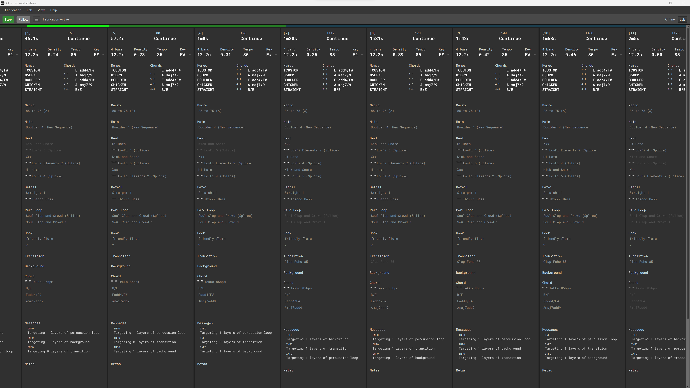

# XJ music workstation

XJ music pioneers the evolution of background audio with our innovative music engine enabling artists to compose new
possibilities for streams, games, and spaces.



*Copyright (c) XJ Music Inc. All Rights Reserved.*

[U.S. Patent 10,446,126](https://patents.google.com/patent/US10446126B1/)

[xjmusic.com](https://xjmusic.com)

## Usage reporting

> **The workstation asks before it sends anything, and sends nothing unless you say yes.**

The first time it opens, the workstation asks whether to share anonymous usage numbers with **Signal**, Outright Mental's own first-party, aggregate-only analytics, with **Yes, share** and **No thanks** side by side. If you say yes, it sends one summary of a few dozen bytes each time you quit: how long it was open, which views and modes you used, which major features you touched, whether music played, and whether anything failed. Every value is a number. It never sends a name or identifier, your projects, files or music, or anything you type.

- **See it, or change your mind:** **Settings › Privacy** (Project › Settings, or Help › Usage Reporting Settings...) has the switch *Share anonymous usage numbers*, and shows the exact bytes of the next summary and what each part means.
- **Turn it off for good:** set `XJ_SIGNAL=off` in the environment, or run with `-Dxj.signal=off`. The tests (`./gradlew test`) run with it off.
- **Exactly what is sent, metric by metric, where it goes, and what is kept on your computer:** [PRIVACY.md](../PRIVACY.md).
- **The code:** [`src/main/java/io/xj/gui/usage/`](src/main/java/io/xj/gui/usage/), the catalog in [`../.signal/`](../.signal/), and Signal's Java core, vendored, in [`vendor/signal-core/`](vendor/signal-core/).

## Setup

### Dependencies

* Java 17
* Gradle 8


### Running the application

This project is built with Gradle. To run the XJ music workstation, run:

```shell
./gradlew :bootRun
```

You should then see the JavaFX GUI open the main window.

Click the Project menu on the top left-hand side and choose Demos to bring up a selection of four demo projects. Click OK to begin cloning the chosen project onto your machine. Once done, the main window will display all of the libraries included in your select project in the Content tab. Click the Fabrication tab in the top right-hand corner to switch to the Fabrication tab, there you can click Start to begin playing the project. 

Click here for a video walkthrough! https://youtu.be/z5i8ZD8AyWE

## Architecture

The command above (`gradle :bootRun`) invokes the `bootRun` task. The `bootRun` task is a
Gradle task provided by the Spring Boot Gradle plugin. It runs the application in the current JVM.

* the `io.xj.engine.craft` package is the most esoteric. It contains all the logic about fabricating music basic on the
  input content.
* the `io.xj.engine.dub` package is an audio mixer-- it consumes the output of the craft package above and uses the
  musical choices as an edit decision list to read the source audio files, use ffmpeg via javacpp to do audio
  resampling, add up the audio files, and send the output back as bytes
* the `io.xj.engine.ship` package consumes the output of the dub package above and sends it either to local system
  output, file output, or HLS stream e.g. youtube output

We recommend starting by ignoring the craft package (very esoteric) and focusing on the dub package (lots of
straightforward algorithms for mixing audio)

